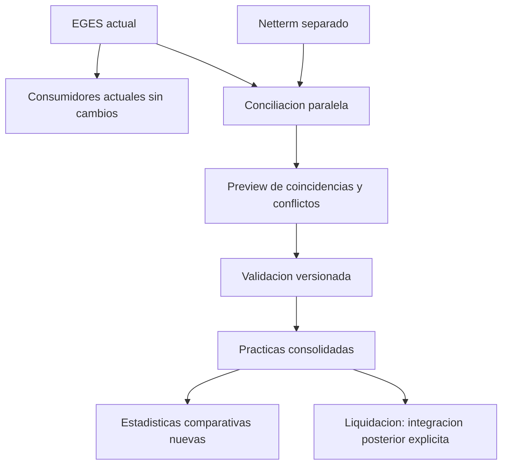

# Importacion y conciliacion EGES / Netterm

Fecha: 2026-11-06.
Estado: importacion y conciliacion implementadas localmente. Consultas paralelas de
produccion y respaldo de origen disponibles; sin despliegue ni cambios economicos.
Los dashboards EGES anteriores conservan sus reglas.

Entrega Codex del 09/11/2026:
[produccion combinada y respaldo profesional](PRODUCCION_Y_RESPALDO_FUENTES_2026-11-09.md).

## Objetivo y limites

Actualizacion funcional Codex del 09/11/2026: el preview V7 separa correspondencia
de identidad de diferencias de estado. Ver
[mejora de identidad y estados](MEJORA_IDENTIDAD_ESTADOS_2026-11-09.md) antes de retomar
la cola de revision o interpretar `requiere_revision_produccion`. Las reglas y los
totales del conteo provisional no se modifican con esta entrega.

Ampliar la cobertura de estudios para estadisticas y auditoria incorporando
Netterm, sin alterar los resultados actuales de EGES ni los montos de Liquidacion.
La primera entrega incluyo el mapa de dependencias y el contrato de datos.
La fase 1 agrega un lector y preview separado; no incluye migracion de
consumidores, importaciones productivas, almacenamiento clinico ni recalculos.

Hipotesis de riesgo verificable: insertar filas Netterm en `EgesRow` cambiaria
automaticamente consultas que hoy asumen estados, fechas y tipos de atencion EGES.
Por eso Netterm debe entrar por un lector y almacenamiento de origen separados.

## Mapa de dependencias actual

| Superficie | Fuente actual | Contrato a preservar |
| --- | --- | --- |
| [Carga y validacion](../../eges_import/forms.py) | Excel EGES XLS/XLSX | Encabezados minimos EGES, limites de archivo y errores de formato. |
| [Entrada HTTP](../../eges_import/views.py) | `ImportBatch`, formulario, parser de servicios | Huella de archivo, rechazo de reimportacion exacta, resultados y navegacion del lote. |
| [Parser y consultas](../../eges_import/services.py) | `EgesRow` | Tipado de fechas/horas, clasificacion de modalidad, insumos y deduplicacion. |
| [Lotes y metricas](../../eges_import/models.py) | `ImportBatch.filas` | Finalizado = estado `Informado`; ingresos distintos por HC, fecha, hora y centro. |
| [Dashboards y endpoints](../../eges_import/urls.py) | Consultas globales y por lote | KPIs, modalidades/submodalidades, franjas, productividad, coberturas, practicas y comparativas. |
| Portal del director | Vistas y servicios de `eges_import` | Acceso por token, filtros, agregados y exportaciones; no ampliar acceso a datos individuales. |
| Exportaciones Excel/PDF | Vistas de `eges_import` | Misma poblacion, periodo y filtros que el indicador mostrado. |
| [Cruces de Liquidacion](../../liquidacion/services_eges.py) | Lote EGES, fecha, DNI/HC, practicas y profesional | Preview, revision, controles versionados y ajustes explicitos; importar no aplica montos. |
| [Evidencia economica](../../liquidacion/models.py) | FK a lote/fila EGES e historial | Preservar identidad, fingerprint y snapshots; no reemplazar filas historicas. |
| [Reversiones](../../liquidacion/services_reversiones.py) | Historial de correcciones y revisiones | Restauracion explicita, nunca borrado del historial. |
| Reclasificacion y diagnosticos | Management commands EGES y scripts locales | No ejecutar sobre Netterm ni consolidacion por el solo hecho de ampliar la carga. |

Este mapa identifica dependencias del codigo, no certifica el estado de una base
productiva. Antes de migrar una pantalla se deben comprobar sus queries y tests
concretos. Las funciones parser legadas de `views.py` no se refactorizan como
efecto lateral de agregar Netterm; la entrada activa debe verificarse por llamada.

Verificacion de la entrada activa: `importar_eges()` llama a
`_procesar_excel_eges`, alias importado de `eges_import.services.procesar_excel_eges`.
La carga web actual exige superusuario. La funcion homonima que permanece en
`views.py` no es el parser llamado por esa entrada.

Dependencias indirectas a preservar: controles/revisiones EGES alimentan el
checklist de cierre de Liquidacion; el cambio de origen no debe resolver ni reabrir
esos pendientes por si solo. En la busqueda de referencias explicitas a modelos
EGES, no se encontraron otros consumidores de runtime fuera de `eges_import` y
`liquidacion`; esto no sustituye una prueba de integracion al migrar consumidores.

## Contrato que EGES mantiene

- `ImportBatch` y `EgesRow` siguen representando exclusivamente datos EGES.
- La clave actual de fila es HC + fecha + hora + centro + practica, global entre
  lotes; no contiene el batch. Cambiarla requiere una tarea independiente.
- El importador omite insumos; no es hoy un archivo crudo completo de cada Excel.
- `archivo_sha256` identifica el contenido del archivo, no al estudio clinico.
- Los selectores de finalizados usan `Informado`; RX sin informe tiene un circuito
  propio (`Entregado Sin Informe`). No equiparar automaticamente otros estados.
- Los KPIs principales cuentan `id` de fila, no suman `cantidad`. No presentar
  una cifra consolidada como comparable hasta fijar la misma unidad de conteo.
- Los periodos existentes basados en `fecha_turno` no pasan a fecha de pedido,
  realizacion o informe sin una migracion explicita del consumidor.
- Historicos contables y controles EGES existentes no se actualizan por importar.

Limitacion actual: la deduplicacion global omite una fila con la misma clave aunque
una exportacion posterior cambie su estado o informante. Ademas, un lote nuevo
parcialmente repetido contiene solo las filas nuevas, no necesariamente la foto
completa del Excel. No usarlo como snapshot completo de periodo en la conciliacion
sin advertir esta diferencia. No se corrige ese comportamiento legacy en esta fase.

## Evidencia de los libros Netterm analizados

Analisis de lectura de los dos XLSX de octubre compartidos por el usuario; no se
incluyen documentos, nombres, pedidos ni otras claves reales en este documento.

| Observacion | ECO | Doppler |
| --- | ---: | ---: |
| Filas validas identificadas | 4010 | 562 |
| Duplicados exactos | 0 | 0 |
| Duplicados por pedido + tipo/codigo nomenclador | 0 | 0 |
| Filas con fecha de realizacion en noviembre | 13 | 15 |
| Filas con fecha de informe en noviembre | 176 | 15 |

Los dos libros no comparten pedido + nomenclador. Compartir paciente o fecha no
prueba duplicacion: hay ocho claves compartidas por documento + fecha de pedido +
codigo, pero con pedidos diferentes. Los nombres de los libros no definen modalidad:
ambos incluyen ecocardiografia y el libro ECO tambien incluye Doppler.

Se detectaron filas de internacion exclusivas de Netterm frente al EGES recibido.
No se demostro que Netterm contenga todo EGES ni que las exportaciones tengan el
mismo universo o fecha de corte. El reemplazo de EGES no esta aprobado.

## Contrato propuesto para Netterm

1. **Lote de origen:** fuente NETTERM, hash, nombre del archivo, usuario, fecha de
   importacion, version del parser, hoja, periodo declarado y periodo observado.
   Estado del lote separado de los estados clinicos.
2. **Fila de origen:** numero de fila y valores originales, incluida toda columna
   sin titulo, mas valores normalizados. Conservar ceros de identificadores y
   errores de conversion; no sustituir un dato invalido por un valor inventado.
3. **Identidad:** pedido + tipo de nomenclador + codigo es una clave candidata por
   fuente. Si se repite, clasificar como repeticion, actualizacion o conflicto;
   no borrar automaticamente. `NRO.VISUAL` es opcional, no clave universal.
4. **Fechas distintas:** guardar pedido/hora, realizacion/hora e informe/hora por
   separado. La columna sin titulo siguiente a una fecha requiere un mapeo
   posicional versionado, validado contra encabezado y tipo de celda.
5. **Estados distintos:** conservar el texto original y mapear a estados separados
   de realizacion, informe y anulacion. `INFORME DEFINITIVO` no se almacena como
   `Informado` en una fila EGES. No inferir elegibilidad economica del estado solo.
6. **Profesionales:** solicitante, informante, tecnico, operador y autor de anulacion
   son roles distintos. No pagar al solicitante ni completar el informante con el
   operador. Nombres truncados o ambiguos requieren vinculacion revisable.
7. **Cantidad:** estos libros no aportan una columna `Cantidad` equivalente a EGES.
   Una fila no autoriza a inventar cantidad economica o bilateralidad. Mantener
   cantidad desconocida hasta definir y probar la semantica de la exportacion.
8. **Clasificacion:** separar ECO general, Doppler y ECOCAR por codigo/catalogo y
   nombre, nunca por nombre del archivo. Sector, marca A/I, urgencia y tipo de
   atencion no son sinonimos; conservarlos antes de aprobar equivalencias.
9. **Codigos:** conservar el nomenclador original. `180112` y `180112/0` pueden ser
   candidatos a equivalencia; no eliminar sufijos o tipos distintos sin una regla
   explicita. Una tabla de equivalencias debe poder tener vigencia y version.
10. **Seguridad:** mismas restricciones de acceso que datos clinicos comparables,
    previews sin PHI en logs, archivos fuera de Git y politica de retencion/borrado
    definida antes de guardar originales con datos personales.

## Conciliacion propuesta

La unidad consolidada es una practica, no un paciente, pedido completo ni informe.
Cada practica puede referenciar varias evidencias originales y varias versiones
del mismo registro. La identidad consolidada no depende de la hora usada para pagar.

- Buscar candidatos por documento tipado/HC compatible, codigo equivalente y fechas
  semanticamente compatibles; no usar nombre de paciente como identificador unico.
- Distinguir `COINCIDENTE`, `SOLO_EGES`, `SOLO_NETTERM`, `AMBIGUO` y `CONFLICTO`.
  Estos resultados de matching son diferentes del estado de validacion humana.
- No vincular automaticamente dos pedidos distintos ni practicar un many-to-many
  implicito para hacer desaparecer discrepancias de cantidad.
- Guardar regla/version de matching, campos comparados, discrepancias y decision
  de revision con actor, fecha y motivo. Reanalizar no debe borrar decisiones previas.
- Conservar cada fecha y cada rol profesional: una preferencia por campo no puede
  convertir todo Netterm en dato EGES ni rellenar horas faltantes silenciosamente.
- Mismo archivo reimportado: no duplica filas. Exportacion posterior: incorpora
  evidencia de cambios de estado/informe, sin contar otra vez la misma practica.

## Plan incremental y gates

| Fase | Entrega | Riesgo / esfuerzo relativo | Gate para avanzar |
| --- | --- | --- | --- |
| 0, este documento | Mapa, contrato y limites | Bajo / bajo | Revision del alcance; ninguna query existente cambia. |
| 1 | Parser Netterm y preview transitorio anonimizables | Bajo / medio | Headers/hojas reales, fechas/horas, errores por fila y clasificacion testeados; sin escrituras clinicas o economicas. |
| 2 | Almacenamiento separado de origen | Medio / medio | Permisos, retencion, atomicidad, reimportacion exacta y nueva exportacion con actualizaciones probados; EGES intacto. |
| 3 | Conciliacion y revision | Medio / alto | Casos ambiguos, cantidades, multiples pedidos, anulaciones y decisiones versionadas cubiertos; sin publicar cifras finales por defecto. |
| 4 | Estadisticas consolidadas opt-in | Medio / medio | Comparar poblacion/periodo contra EGES; etiqueta de fuente; rollback por consumidor sin borrar datos. |
| 5 | Integracion contable | Alto / alto | Reglas de profesional, cantidad y hora aprobadas; preview, permisos, snapshots y reversion; ninguna escritura automatica al importar. |

### Criterios de no regresion

- Los mismos fixtures EGES producen los mismos lotes, filas, KPIs, exportaciones y
  resultados de cruces antes y despues de agregar el parser Netterm.
- Subir un libro Netterm no altera filas EGES, metricas existentes, montos,
  revisiones, estado de sesiones ni snapshots RRHH.
- Un archivo mixto no se duplica al importarlo en dos libros ni por reintento.
- Estadisticas futuras explicitan fecha eje (pedido, realizacion, informe), estado
  incluido y unidad (filas, practicas, cantidades, pacientes o ingresos).
- Diferenciar desconocido de cero y provisional de validado. Practica realizada,
  informe definitivo y derecho a cobro son tres decisiones distintas.
- No se cambia produccion ni se prueban archivos reales contra su base. Fixtures
  sinteticos en tests y libros reales solo en entorno aislado con limpieza final.

### Casos minimos del primer parser

- Libro ECO y libro Doppler de 37 columnas; hoja vacia adicional ignorada.
- Encabezados repetidos/vacios de horas: mapeo por posicion validado, nunca por
  un diccionario que pise todas las columnas sin titulo.
- Filas vacias o no clinicas identificadas, sin convertirlas en estudios.
- Pedido de octubre con realizacion/informe de noviembre conserva las tres fechas.
- Documento, codigo o cantidad ausentes quedan desconocidos y generan advertencia.
- Mismo paciente/fecha/codigo con pedidos distintos queda como posible coincidencia,
  no duplicado confirmado; el parser no hace conciliacion ni elimina evidencia.
- Reportar conteos por estado, modalidad y errores sin pacientes ni nombres en logs.

### Verificacion por fase

Parser EGES y endpoints: `python manage.py test eges_import --verbosity=1`.
Si una fase toca un consumidor de Liquidacion, leer antes sus instrucciones y
ejecutar sus tests focales de cruce, jornada u horario segun el alcance.
Si toca modelos: `python manage.py makemigrations --check --dry-run`.
Una fase solo documental se verifica con diff y enlaces locales, no requiere Django.

## Decisiones antes de implementar persistencia o consolidacion

- Confirmar significado de las marcas A/I y de cada hora de Netterm con el origen;
  no reemplazar `Hora Desde` EGES por hora de pedido o realizacion.
- Acordar si el indicador principal mide realizados o informados y que fecha usa.
- Confirmar unidad/cantidad de fila Netterm, posibles repeticiones de codigo dentro
  de un pedido y semantica de anulacion/reemplazo.
- Definir como se resuelve un profesional ausente o truncado y quien valida.
- Aprobar retencion del archivo/fila cruda, permisos y politica de rectificaciones.
- Definir si los estudios solo Netterm de internacion se publican tras validacion;
  su ingreso a estadisticas no habilita automaticamente liquidacion.

## Fase 1 implementada

- Lector: [services_netterm.py](../../eges_import/services_netterm.py),
  `preparar_preview_netterm`, version `NETTERM_37_V1`. No consulta modelos.
- Acceso: superusuario, desde Importar EGES -> Netterm / Vista previa,
  `/eges/netterm/preview/`. Formulario y endpoint separados del importador EGES.
- Un libro XLSX por peticion, 37 columnas en orden original; no acepta XLS legacy
  ni un Excel EGES presentado como Netterm. Limites: 10 MB comprimidos, 100 MB
  expandidos y 20000 filas. Rechaza exceso de filas en vez de recortar silenciosamente.
- Conserva valores originales en el resultado transitorio del parser; normaliza
  fechas/horas por posicion, roles y estados separados. Cantidad permanece desconocida.
- Filas vacias/encabezados repetidos se omiten; formulas y filas sin clave suficiente
  generan advertencia sin copiar valores personales al mensaje. Claves repetidas
  se marcan pero no se borran ni se concilian con otros libros.
- La pantalla recibe solo agregados, periodos, version/hash y hasta 100 ubicaciones
  de advertencias; conserva el conteo completo. No muestra pacientes, documentos o
  profesionales y no retiene las filas en la sesion del usuario.
- No crea `ImportBatch`, `EgesRow`, registros contables, revisiones ni tablas nuevas.
  Django puede usar su upload temporal normal durante la peticion; no hay almacenamiento
  aplicativo del archivo ni del resultado al finalizarla.
- Faltantes o valores invalidos se conservan como desconocidos, no como cero. La
  clasificacion por nombre es provisional, no reemplaza el catalogo ni valida cobro.

### Verificacion de la fase 1

Tests sinteticos en [eges_import/tests.py](../../eges_import/tests.py): parser sin
acceso a DB, permisos, formulas, periodos distintos, duplicados, limites, estado
vacio, archivo invalido y ausencia de escrituras en EGES/Liquidacion.
Ejecutar `python manage.py test eges_import --verbosity=1` como gate de no regresion.

Lectura de los libros reales sin importacion: 4010 filas identificables y dos
omitidas en ECO; 562 en Doppler. Cero claves de pedido/nomenclador repetidas dentro
de cada libro. Conservadas las realizaciones e informes de noviembre. El preview
advierte informantes ausentes y no intenta asignarlos por semejanza.

QA visual con SQLite temporal y workbook sintetico: login, estado inicial, error
de encabezado, recuperacion con archivo valido, resultado agregado, contraste y
desktop/mobile. No hay desbordamiento del documento a 390 px de viewport; las
tablas usan scroll propio. El servidor y los datos temporales se eliminan al terminar.

## Fase 2 implementada

Decision del usuario: conservar filas originales y normalizadas sin almacenar el
XLSX. Las versiones se conservan sin borrado automatico; una eliminacion requiere
solicitud explicita y procedimiento controlado. No se agrega un endpoint de borrado.

- Modelos separados [NettermLote y NettermFila](../../eges_import/models.py),
  migracion `0010_nettermlote_nettermfila`. No altera tablas EGES ni Liquidacion.
- Lote: hash unico del archivo, version del parser, autor, fecha, motivo, resumen
  y ubicaciones limitadas de advertencias. Se crea completo en una transaccion.
- Fila: ubicacion original, 37 valores originales con tipo y valor serializados,
  normalizados, fechas distintas, estado y huellas de contenido/clave candidata.
  La clave candidata es pedido + tipo de nomenclador + codigo, no paciente/fecha.
- Clases de observacion: NUEVA, REITERADA, ACTUALIZADA y AMBIGUA. La referencia
  previa solo se vincula si existe una observacion inequivoca en el ultimo lote de
  esa clave y su documento/HC coincide. Claves repetidas, identidad dudosa o
  ambiguedad previa permanecen ambiguas; importar no las resuelve.
- No existe todavia una entidad consolidada de estudio. Dos libros pueden conservar
  evidencias repetidas sin que esas filas se sumen a indicadores finales. Los conteos
  NUEVA/ACTUALIZADA describen observaciones de importacion, no validacion clinica.
- Cada exportacion es un snapshot separado, no un delta que sobrescriba el anterior.
  Una observacion anterior que no aparezca en un libro posterior no se elimina ni
  se considera anulada por ausencia. Las referencias describen lo observado al
  importar; no son una resolucion definitiva de identidad entre fuentes.
- Los modelos bloquean sobrescrituras mediante `save`; no se registran como modelos
  editables en admin. Scripts/SQL privilegiados deben respetar la politica de origen
  inmutable; no hay triggers de inmutabilidad en esta fase.

### Flujo de uso de fase 2

1. Superusuario abre Importar EGES -> Netterm / Vista previa.
2. Selecciona el XLSX y revisa agregados, fechas y advertencias; el preview no guarda.
3. Para guardar, vuelve a seleccionar el mismo archivo, ingresa un motivo y marca
   la confirmacion. Esta segunda seleccion evita retener el archivo o PHI en sesion.
4. El token firmado dura 15 minutos y contiene solo usuario, hash y version del
   parser. El servicio relee el XLSX y rechaza cambios respecto al preview.
5. Se muestra el lote en `/eges/netterm/lotes/`. Un archivo identico devuelve el
   lote existente sin duplicar filas. Un fallo al guardar filas revierte todo el lote.

Las rutas de guardado y listado tambien requieren superusuario. Guardar solo acepta
POST y exige confirmacion y motivo. El listado muestra metadatos de lotes y conteos,
no documentos, nombres de pacientes ni contenido clinico de las filas archivadas.
No hay archivo XLSX descargable porque no se conserva en servidor.

## Netterm: modalidades y materiales (07/11/2026)

- Lector `NETTERM_37_V3`: agrega TC, RM, RX, MAM, DX (densitometria) y SERIE
  reutilizando la clasificacion textual existente de EGES, sin cambiarla. Mantiene
  ECO_GENERAL, DOP y ECOCAR. Descripciones desconocidas quedan SIN_CLASIFICAR;
  la clasificacion no es una validacion por catalogo.
- Las filas identificables se conservan completas, incluidos los materiales. Se
  agrega `es_insumo` en los normalizados y se separan `filas_practicas` y
  `filas_insumos`; la distribucion por modalidad no suma insumos.
- La deteccion de materiales usa descripcion, no la regla numerica de codigos EGES:
  no se demostro que ambos nomencladores compartan esa semantica. Una practica
  reconocida con la expresion CON/SIN CONTRASTE o CON/SIN SEDACION no se considera una fila de material
  por esa expresion; una fila de contraste o jeringa se marca como insumo.
- Conciliacion V3 excluye esas filas tambien en lotes antiguos, recalculando la marca
  desde su descripcion sin sobrescribir el archivo ni sus metadatos historicos. Una
  reimportacion identica sigue devolviendo el lote archivado, sin reclasificarlo.
- Un paciente con varias practicas mantiene todas sus filas. No se suman materiales
  como estudios, no se infieren cantidades y no se publican estadisticas consolidadas.
- Tests sinteticos incluyen TC + contraste + jeringa, material radiografico,
  densitometria y multiples practicas del mismo paciente. No hay migraciones nuevas
  ni cambios en el importador EGES o Liquidacion.
- QA con workbook sintetico y SQLite aislada: el lector muestra 4 filas identificables,
  2 de practicas y 2 de insumos; modalidad TC y DX sin materiales. La conciliacion
  conserva las dos practicas Netterm y excluye los dos materiales. Desktop/mobile
  sin desbordamiento de pagina; servidor y carpeta temporal eliminados.
- Correccion EGES posterior autorizada (07/11/2026): `EgesRow.clasificar_insumo`
  deja de considerar CON/SIN CONTRASTE una senal de material en una practica de
  modalidad reconocida. Los codigos de insumo siguen teniendo prioridad; contraste
  independiente, jeringas, agujas y materiales siguen excluidos. Tests reproducen
  el descarte anterior y comprueban que se conservan dos TC del mismo paciente.
  No hay reclasificacion historica ni recalculo contable: importar un lote nuevo
  conserva intacta una fila historica con `es_insumo=True`. Una carga futura puede
  incorporar practicas que antes eran omitidas; revisar historicos es otro alcance.

## Analisis conjunto por periodo: primer tramo (07/11/2026)

- El preview permite elegir varios lotes EGES y Netterm y fechas desde/hasta
  inclusivas. Los enlaces antiguos `batch_eges` siguen funcionando; la seleccion
  nueva usa `lotes_eges` repetidos en GET. No hay tope de diez lotes para analizar.
- Motor V5: usa Fecha Turno EGES y Fecha Pedido Netterm. El ID/fecha de importacion
  no demuestra cronologia de exportacion. Observaciones de una clave con distinto
  contenido quedan como vigencia incierta y no aportan automaticamente. El periodo
  conserva un grupo incierto si alguna de sus fechas cae dentro, sin elegir version.
  Sin fecha, una observacion no participa de un rango fechado; sin rango sigue visible.
- Las distintas practicas del mismo paciente se conservan. Candidatos EGES de
  distintos archivos siguen siendo ambiguos cuando corresponda, sin elegir uno.
- La consulta carga solo campos necesarios de EGES y lee Netterm por bloques de
  500 filas. La huella incluye la seleccion y el periodo; no escribe origenes,
  montos ni cifras publicadas.
- La auditoria existente de escritura sigue limitada a un lote EGES, sin filtro de
  fechas y hasta diez lotes Netterm. En conjuntos mayores o periodos filtrados se
  muestra historial pero no formularios de guardado; no se cambia su esquema.
- Sigue el limite de seguridad de 50000 observaciones por analisis sincrono; una
  superacion se rechaza, no se recorta. Tras quitar la subconsulta se suman las filas
  EGES no-insumo del periodo y TODAS las observaciones Netterm seleccionadas ANTES
  de filtrar periodo o insumos. Un periodo pequeno puede excederlo por libros grandes
  o muchas versiones seleccionadas. Los limites del lector Netterm (10 MB/20000
  filas) no se ampliaron. Decision posterior: no implementar almacenamiento temporal
  remoto, cola ni worker con los archivos actuales; medir antes de ampliar capacidad.
- No hay nueva estadistica consolidada ni integracion contable en esta entrega.
- Validacion: suite EGES/Netterm de 95 tests OK, sin migraciones pendientes. QA
  aislado con dos lotes por fuente y octubre: dos correspondencias, noviembre
  excluido, sin formularios POST. Periodo invertido muestra error y conserva los
  lotes seleccionados. Desktop/mobile sin overflow de pagina; entorno eliminado.

## Medicion real y reglas del conteo provisional (07/11/2026)

Decision: mantener limites y flujo sincrono; no agregar MinIO para imports, cola,
worker ni nueva infraestructura. Se midieron los tres archivos reales en SQLite
temporal, con DEBUG=False, aislamiento comprobado antes de migrar y limpieza tras
cerrar conexiones. Ninguna medicion uso bases clinicas o credenciales productivas.

| Operacion | Resultado local |
| --- | --- |
| Importacion EGES de 3748 filas no-insumo | 2,056 s |
| Netterm ECO, lectura inicial / guardado con relectura | 2,201 s / 3,880 s |
| Netterm Doppler, lectura inicial / guardado con relectura | 0,351 s / 0,577 s |
| Reimportacion identica ECO / Doppler | 2,298 s / 0,290 s, sin duplicar filas |
| Conciliacion completa inicial | 1,103 s |
| Conciliacion de octubre con subconsulta correlacionada | 217,085 s |
| Octubre tras quitar esa subconsulta, tres corridas finales | 1,479 s / 1,601 s / 1,467 s |
| Guardado final con lector V3, ECO / Doppler | 3,137 s / 0,450 s |

La lentitud era de la consulta de periodo, no del tamano de archivo. Ahora se leen
las observaciones seleccionadas por bloques y se filtran los grupos en memoria,
dentro del guard previo al periodo Netterm. No se aumentaron limites. Son tiempos
locales, no certificacion PostgreSQL/Heroku ni carga concurrente.

La medicion detecto 17 falsos positivos Netterm por SEDACI en practicas con sedacion;
V3 los conserva como practicas, sin cambiar EGES. Sedacion/medicacion independientes
siguen siendo insumos. Los libros medidos ahora tienen cero insumos detectados y
55 observaciones SIN_CLASIFICAR: no se asignan a una modalidad por conveniencia.

### Contrato implementado: INFORMADAS_TURNO_PEDIDO_V2

Servicio `construir_preview_conteo_consolidado` en `services_conciliacion.py`; no esta
conectado a dashboards, exports ni Liquidacion y no crea tablas o eventos de auditoria.

1. Indicador: **practicas informadas por fecha de turno EGES / pedido Netterm**.
  No llamarlo produccion realizada, fecha de informe ni fecha de cobro. El periodo
  es inclusivo y no asume cronologia por orden de importacion. Fechas ausentes
  quedan pendientes sin rango; con rango quedan fuera porque no pueden ubicarse.
2. Unidad: fila de practica identificada, deduplicada entre fuentes; no paciente,
  pedido completo ni suma de `cantidad`. Cantidad Netterm sigue desconocida. Dos
  practicas distintas o turnos repetidos legitimos del mismo paciente se conservan.
3. Base: cada fila EGES no-insumo se cuenta una sola vez por PK si esta INFORMADO,
  tiene fecha y modalidad conocida. Cancelado/anulado se excluye; otros estados o
  clasificacion OTROS quedan separados como pendientes, no se remapean historicos.
4. Aporte Netterm: solo SOLO_NETTERM inequivoco, no anulado, DEFINITIVO, con fecha y
  modalidad conocida. ECO_GENERAL/DOP/ECOCAR se agrupan como ECO para comparar con
  la modalidad principal EGES; sus detalles de origen permanecen archivados.
5. Compartidos: COINCIDENTE no agrega otra unidad Netterm. Diferencias de informante
  no exigen revision individual para este indicador y no determinan el beneficiario.
6. Multiples: no elegir el primero ni sumar todo Netterm. La base EGES conserva sus
  practicas legitimas y cada grupo Netterm elegible ambiguo/conflictivo queda como
  correspondencia pendiente. Repetidos dentro de la misma exportacion no se borran;
  observaciones identicas entre libros no son nuevas practicas. Sin fecha de
  exportacion verificada, contenidos diferentes quedan en vigencia pendiente;
  importar una exportacion antigua despues no la declara vigente. La fila mostrada
  es una referencia de evidencia, no una eleccion de version actual. Un unico libro
  describe el snapshot seleccionado, no acredita ser el mas reciente global.
  Los pendientes son
  grupos/casos, no un numero de estudios adicionales confirmado.
7. Estados: solo INFORMADO/DEFINITIVO entran a este indicador. Informe Entregado,
  Fin Practica y otros estados no se equiparan sin evidencia. RX Entregado Sin
  Informe pertenece a un indicador separado; su circuito EGES actual no cambia.
8. Clasificacion pendiente: no imputar modalidad desconocida ni contarla como aporte
  confirmado. El resultado separa motivos pendientes y exclusiones. No contiene
  nombres/DNI y no reemplaza los KPIs actuales ni las cantidades economicas.
9. Auditoria: conservar el alcance actual, solo herramienta de excepciones. Este
  conteo no escribe ni usa decisiones para consolidar automaticamente o pagar.
10. Pacientes: union de DNI normalizados entre las practicas incluidas de ambas
  fuentes. Se quitan puntos/espacios y ceros iniciales; DNI cero/invalido o tipo
  distinto de DNI no identifica. No usar HC/nombres para inferir identidad. Las
  claves internas usan HMAC y el conteo retorna solo cantidades, nunca documentos.
  Se informa por separado cuantas practicas incluidas no tienen identidad y cuantas
  filas/grupos consultados no se pudieron identificar. No estimar pacientes unicos
  desconocidos ni sumar pacientes de distintas modalidades como si fueran distintos.

### Desglose verificado de octubre (08/11/2026)

| Bloque | Cantidad | Efecto sobre 3634 + 666 |
| --- | --- | --- |
| EGES INFORMADO, fecha y modalidad conocidas | 3634 | Base incluida |
| EGES con otros estados | 114 | Pendiente; puede aumentar si se confirma elegibilidad, no por reinterpretacion automatica |
| Netterm exclusivo elegible | 666 | Aporte incluido |
| Netterm elegible compartido | 3356 | Sin aporte adicional; ya representado en EGES |
| Netterm definitivo sin clasificar | 53 | Puede cambiar total solo si ademas es exclusivo/elegible |
| Netterm correspondencia no resuelta | 204 | Puede aportar cero o mas practicas, nunca todos los candidatos por defecto |
| Netterm no definitivo | 231 | Pendiente de estado; muchos casos no serian adicionales aunque cambien |
| Netterm anulado | 62 | Excluido con evidencia actual; solo una rectificacion puede cambiarlo |
| Netterm insumo detectado | 0 | Excluido si existe; nunca se agrega como practica |

EGES: 3634 + 114 = 3748 filas. Netterm: 666 + 3356 + 53 + 204 + 231 + 62 = 4572
grupos en estos dos libros. Las categorias son motivos primarios exclusivos por
grupo/fila en esta ejecucion; no sumar pendientes de ambas fuentes como practicas
adicionales, ni usar sus cantidades como cota superior de produccion.
Total provisional: 4300 practicas informadas por fecha de turno/pedido, no realizadas.
Pacientes identificables entre incluidas: 2608. No identificables: 60 grupos Netterm
consultados (no incluidos como aporte); cero practicas incluidas sin identidad en
esta muestra. No son 60 pacientes nuevos o distintos confirmados.

### Validacion real de otras modalidades (08-09/11/2026)

SQLite temporal, archivos EGES de mayo, sin alterar filas despues de importar:

| Exportacion | Filas no-insumo persistidas | Practicas informadas incluidas | Pacientes identificables | Pendientes de estado |
| --- | --- | --- | --- | --- |
| Atendidos-mayo-TC-2026.xls | 1217 | 1178 | 991 | 39 |
| Atendidos-mayo-RM-2026.xls | 569 | 556 | 423 | 13 |
| Atendidos-mayo-Rx-2026.xls | 3586 | 1455 (1392 RX + 63 SERIE) | 883 | 2131 |
| Atendidos-mayo-Mamo-2026.xls | 559 | 553 | 266 | 6 |
| Atendidos-mayo-Densito-2026.xls | 147 | 147 | 128 | 0 |

TC tiene una practica incluida sin DNI identificable; se cuenta la practica, no
se inventa el paciente. RX trae dos duplicados omitidos por el importador existente;
esa regla EGES no se cambio. Tiempos locales de conteo entre 0,166 y 0,342 s.
Ademas se recibieron y leyeron los Netterm TC, RM, RX, DX y Seriada. No se recibio
archivo Netterm MAM independiente; el libro etiquetado RX clasifica por contenido
646 filas como MAM y 53 como SERIE, que se compararon en grupos separados. No asumir
que el nombre del archivo define modalidad.

Los pares siguientes son vistas por modalidad y se solapan: el mismo libro RX aporta
RX, MAM y SERIE, y algunos grupos de clave se comparten entre exportaciones. No sumar
sus aportes individuales; para el total usar el analisis conjunto deduplicado.

| Par por práctica clasificada | EGES informadas | Netterm elegibles exclusivas en el par | Compartidas | Ambiguas | Conflicto | Pendientes/excluidas |
| --- | ---: | ---: | ---: | ---: | ---: | --- |
| RM | 616 | 299 | 584 | 2 | 15 | 58 estado no definitivo; 11 correspondencia; 71 anuladas |
| RX (sin SERIE) | 1404 | 441 | 1361 | 188 | 2051 | 2657 estado no definitivo; 1831 correspondencia; 76 anuladas |
| MAM (filas del Netterm RX) | 624 | 0 | 607 | 23 | 14 | 22 estado; 17 correspondencia |
| DX | 187 | 0 | 179 | 2 | 5 | 7 estado; 4 correspondencia |
| SERIE (Netterm Serie + filas del Netterm RX) | 65 | 3 | 47 | 2 | 1 | 2 estado; 2 correspondencia; 5 anuladas |
| ECO/DOP/ECOCAR | 3634 | 666 | 3356 | 209 | 201 | 229 estado; 204 correspondencia; 62 anuladas |
| TC | 1145 | 1067 | 1034 | 69 | 111 | 143 estado no definitivo; 75 correspondencia; 89 anuladas |

RX Netterm contiene filas clasificadas MAM/SERIE, por lo que las matrices se filtraron
por modalidad de ambos lados; el cruce RX no arrastra MAM ni seriografias. El archivo
Netterm TC pudo leerse en la corrida final. Estos son resultados del motor actual, no
cifras aceptadas/publicadas. Los casos con conflictos de modalidad o estado requieren
revisar la regla/fuente; no aprobar cientos de pares.

Conteo conjunto provisional con las trece exportaciones: EGES informadas 7675 + aporte
Netterm exclusivo 2460 = **10135**. Por modalidad: ECO 4300, TC 2212, RM 915, RX 1829,
SERIE 68, MAM 624 y DX 187. Los aportes por pares de la tabla suman 2476, no 2460,
porque vistas separadas vuelven a presentar grupos solapados; el conjunto cuenta cada
clave seleccionada una vez y deja divergencias sin vigencia verificada como pendientes.
La suma de los pares filtrados es 16 mayor que el aporte exclusivo conjunto: 16 filas
Netterm RX son candidatas a EGES SERIE y, en el cruce conjunto, quedan en conflicto;
no son un aporte RX confirmado.
Pacientes identificables union-DNI: 4751; 219 grupos Netterm consultados sin DNI
utilizable. Insumos Netterm: 102 (3 TC y 99 RM), conservados en origen y excluidos.
La regla RM V3 recupero 33 angioresonancias `S/CONTRASTE` como practicas; las 99 filas
restantes marcadas insumo corresponden a señales de sustancia/anestesia. RX Netterm
aporta sus filas clasificadas por practica, incluidas 646 MAM y 53 SERIE separadas.
Es una calibracion provisional, no produccion realizada ni cifra publicada; no se
conecta a Liquidacion.

## RX: principal/subsiguiente, estudios, unidades y pacientes (09/11/2026)

**Ampliacion Codex del 09/11/2026:** ver
[analisis por conjuntos y retoma para Copilot](ANALISIS_RX_CONJUNTOS_2026-11-09.md).
Se analizaron tambien los 1110 pedidos con multiples candidatas EGES: 1040 tienen
firma de codigos univoca por pedido/agrupacion, 58 tienen competencia y 12 no igualan
una agrupacion completa. La busqueda amplia `SUBSIG` detecta abreviaturas omitidas
por `SUBSIGUIENTE`. Esta evidencia no asigna cantidades ni valida estudios/proyecciones;
no cambia los conteos del motor. El detalle previo siguiente describe la corrida
anterior y debe leerse junto con esa ampliacion.

La lectura agregada de `Atendidos-RX-Octubre-26.xls` encontro 3570 filas no-insumo
del archivo (3505 RX y 65 SERIE), con 1469 INFORMADO entre ambas modalidades.
Las cantidades siguientes corresponden a las 3570 filas del archivo, no solo RX:
2512 con 1, 982 con 2, 11 con 0, 31 con 4,
26 con 3, 3 con 5, 3 con 6, 1 con 7 y 1 con 8. Hay 736 descripciones con
SUBSIGUIENTE: 689 tienen cantidad 1, 41 cantidad 2, 3 cantidad 0, 2 cantidad 4 y
1 cantidad 3. Ademas, 286 filas INFORMADO tienen cantidad 2, no necesariamente con
la palabra subsiguiente. Por tanto, ni el texto ni cantidad 2 establecen por si solos
la relacion con filas Netterm o su unidad (estudio, proyeccion/unidad de practica).

Agrupando EGES por DNI/fecha/hora/centro/protocolo se observan 1126 grupos repetidos
(2489 filas); todos esos grupos tienen codigos distintos en esta exportacion. Esto
demuestra practicas multiples en un mismo turno, pero no que cada par sean proyecciones
de un unico estudio. `region_informe` esta presente; Netterm RX tiene que compararse
por pedido, documento, fecha de pedido, region/patologia y codigos antes de concluir.

Tests nuevos preservan ambas representaciones de origen sin interpretarlas: dos filas
Netterm principal/subsiguiente con codigos distintos siguen separadas; una fila EGES
`RADIOGRAFIA DE TORAX + SUBSIGUIENTE`, cantidad 2, sigue siendo una fila con cantidad
2. No se asigna cantidad a Netterm, no se descarta la subsiguiente como duplicado y
no se suma automaticamente como practica/estudio adicional.

### Contraste estructural Netterm RX vs EGES RX

Netterm RX legible: 6366 filas clasificadas RX, con DNI y fecha en 6269; 3489 grupos
pedido/DNI/fecha, 2277 de multiples filas (5057 filas, todas con codigos distintos).
En esos grupos, 184 contienen una fila cuya descripcion incluye SUBSIGUIENTE; 864
filas RX del libro contienen ese texto en total. El resto de SUBSIGUIENTE en el libro
puede aparecer en grupos de una fila.

Al buscar EGES por DNI/fecha en los 2277 grupos Netterm multifila: 1163 sin candidata,
928 con 2 filas EGES, 71 con 3, 73 con 4, 14 con 5, 15 con 6, 2 con 7, 7 con 8 y solo
4 con una. Entre estos cuatro, solo dos contienen un codigo EGES presente en Netterm;
ninguno coincide exactamente por region. La cantidad EGES iguala filas Netterm en
cero casos; solo un caso tiene cantidad mayor o igual. EGES numero_turno/protocolo y
Netterm pedido/NRO.VISUAL tampoco coincidieron en los candidatos unicos inspeccionados.

Conclusión: estos archivos no demuestran una correspondencia 1 EGES cantidad=2 con
2 filas Netterm. Las 736 descripciones EGES SUBSIGUIENTE conservan cantidades variadas
y el texto solo no determina unidades. No asignar cantidad Netterm, no descartar filas
subsiguientes y no sumar automáticamente. Los 10135 siguen provisionales; el aporte RX
no debe tratarse como confirmado hasta validar los candidatos excepcionales, sobre todo
los 16 candidatos RX contra SERIE de la comparación conjunta.

Calibracion provisional de octubre: base EGES 3634 + aporte Netterm 666 = **4300**,
modalidad principal ECO. Pendientes: 114 filas EGES no informadas, 53 grupos Netterm
definitivos sin clasificar, 204 correspondencias no resueltas y 231 estados Netterm
no definitivos. Excluidos: 62 anulados Netterm. No es una cifra publicada/final.
La conciliacion arroja 3408 coincidencias, 84 solo EGES, 754 solo Netterm, 209 ambiguos
y 201 conflictos; estos casos no se suman como practicas. Se verifico la huella EGES
antes/despues del guardado/cruce y cero cambios en registros, sesiones o revisiones.

## Criterios de aceptacion de la futura pantalla (08/11/2026)

Esta seccion define gates, no habilita la pantalla ni declara terminado el producto.
El conteo permanece provisional; sin nueva infraestructura, ampliacion de auditoria,
despliegue o conexion a Liquidacion. El usuario aportara exportaciones EGES/Netterm
del mismo periodo para las modalidades restantes antes de cerrar la calibracion.

### Indicadores y trazabilidad

1. Identificacion visible: **practicas informadas por fecha de turno/pedido**, unidad
  practica y etiqueta provisional. No usar produccion realizada, cantidad economica
  ni pacientes como sinonimos. Mostrar periodo inclusivo, lotes por fuente y version
  de reglas; un cambio de seleccion debe recalcular el contexto completo.
2. Practicas: mostrar base EGES, aporte exclusivo Netterm y total provisional; debe
  cumplirse `total = base_eges + aporte_netterm`, globalmente y por modalidad. Las
  practicas compartidas no vuelven a sumar. Conservar las distintas practicas y
  repeticiones legitimas del paciente; no deduplicar por paciente/fecha solamente.
3. Pacientes: mostrar **pacientes unicos identificables de las practicas incluidas**
  por separado. Es la union entre fuentes, no la suma de pacientes EGES/Netterm ni
  de subtotales por modalidad. Los pacientes del aporte Netterm corresponden solo
  a sus practicas exclusivas incluidas, no a todas las observaciones del libro.
  Si se muestran desgloses por fuente, explicar su interseccion y verificar la union.
4. No identificables: mostrar cantidades de practicas incluidas sin DNI utilizable
  separadas de filas/grupos consultados sin identidad. No sumar esos casos a los
  pacientes unicos ni suponer que cada uno es otra persona. Explicitar cobertura
  parcial de identidad, sin exponer DNI, nombres, HC o claves HMAC en el resumen.
5. Pendientes: separar estado, clasificacion, fecha, correspondencia y vigencia.
  Mostrar cantidad, unidad (fila EGES o grupo Netterm), motivo primario y posibilidad
  de cambiar el total. No presentarlos como practicas adicionales ni como cota
  superior; un caso resuelto puede seguir pendiente por otra condicion.
6. Exclusiones: separar materiales y anulaciones de pendientes. Explicar que no
  aportan con la evidencia actual, aunque una rectificacion de origen o un falso
  positivo de clasificacion pueda cambiar el resultado futuro. No borrar originales.
7. Fechas y estados: no sustituir fechas ausentes por informe/importacion ni remapear
  estados sin evidencia. Informar cuando el rango deja observaciones sin fecha fuera
  del analisis; no confundir ausencia de cobertura con cero produccion. RX Entregado
  Sin Informe sigue separado de este indicador y de su circuito EGES actual.
8. Versiones: una exportacion importada despues no adquiere vigencia. Contenidos
  divergentes sin cronologia verificada permanecen pendientes; mostrar que la
  seleccion describe evidencia disponible, no garantiza el ultimo estado global.

### Flujo operativo y validacion

- No exigir aprobar cada coincidencia ni condicionar el acceso al resumen a resolver
  todos los pendientes. Mostrar primero agregados por causa y modalidad; el detalle
  individual queda para excepciones concretas. No agregar validacion masiva de casos
  inciertos como atajo ni convertir la auditoria en un requisito por practica.
- Revisar patrones de causa comun antes de abrir cientos de casos. Una regla general
  debe estar respaldada por significado del origen/catalogo y fixtures representativos;
  comparar el preview anterior/nuevo y versionar el cambio. El reanalisis no modifica
  originales, eventos anteriores, estados contables ni montos historicos.
- Validar con pares de exportaciones reales del mismo periodo de cada modalidad,
  incluida DX. La prueba EGES sola y los fixtures sinteticos no certifican el aporte
  Netterm de esa modalidad. Documentar fecha de corte, cobertura, clasificacion y
  explicacion de diferencias, sin exigir que ambos archivos tengan identico universo.
- Gates automatizados: totales por fuente/modalidad, union de pacientes, casos sin
  identidad, insumos, estados, fechas ausentes, archivos reiterados, orden de carga
  invertido y correspondencias multiples. El GET debe ser read-only y mantener los
  permisos actuales; no modificar estadisticas EGES existentes ni auditoria.
- Antes de aceptar la interfaz, recorrer seleccion inicial, resultado, vacios, errores
  y cambio de filtros en navegador con datos aislados. Revisar desktop/mobile y que
  fechas, indicadores y motivos no se superpongan ni oculten el caracter provisional.
- Rendimiento: medir guardado/cruce con archivos representativos y entorno declarado.
  Mantener 10 MB/20000 filas por lector y 50000 para analisis; este ultimo suma EGES
  del periodo y TODAS las observaciones Netterm seleccionadas antes de su filtro.
  Si se excede, mostrar rechazo explicito, nunca resultados truncados o ceros aparentes.
  Los tiempos SQLite locales no certifican Heroku/PostgreSQL ni concurrencia.
- No aceptar como terminado mientras falten pares reales por modalidad o se presenten
  pendientes como confirmados. Conectar una pantalla requerira una tarea posterior;
  estos criterios no autorizan despliegue ni modificacion de consumidores actuales.

### Excepciones: regla general frente a revision individual

| Causa | Tratamiento prioritario | Cuando necesita revision individual |
| --- | --- | --- |
| Practica con contraste/sedacion marcada como material | Corregir patron general con ejemplos de practica y material independientes | Descripcion/codigo que siga siendo ambiguo o contradiga el catalogo |
| SIN_CLASIFICAR repetido para una misma practica | Verificar significado/codigo y ajustar clasificacion general versionada | Practica mixta, codigo reutilizado o evidencia insuficiente para una modalidad |
| Estados alternativos recurrentes | Confirmar semantica con el origen; incorporar equivalencia solo si corresponde a este indicador | Estados contradictorios de un estudio o anulacion/reemplazo no explicados |
| RX Entregado Sin Informe | Mantener indicador/circuito separado; no aprobarlo manualmente como INFORMADO | Caso que realmente contradiga su estado de origen |
| DNI con puntos, espacios o ceros iniciales | Normalizacion general probada para conteo de pacientes | Documento ausente/invalido, tipo distinto o identidades contradictorias; nunca inferir por nombre/HC |
| Fecha ausente por un formato de exportacion conocido | Corregir conversion general si el valor fuente permite recuperarla | Fecha no disponible o eventos incompatibles; no inventar turno/pedido a partir de otra fecha |
| Exportaciones repetidas con contenido identico | Aplicar agrupacion existente y conservar evidencias, sin aprobaciones por fila | Repeticiones dentro de un mismo pedido/exportacion sin identificador que distinga practicas legitimas |
| Contenidos divergentes y cronologia desconocida | Obtener fecha de exportacion verificable/cobertura o seleccionar conscientemente la evidencia disponible | Persisten versiones contradictorias de una clave sin forma de determinar vigencia |
| Multiples candidatos por nomenclador/fecha mal interpretados | Corregir una equivalencia o semantica general verificada y reanalizar | Varias practicas/turnos legitimos siguen siendo posibles; no elegir el primero ni fusionarlos |
| Informante EGES/Netterm distinto o incompleto | Alerta no bloqueante para este conteo; no requiere revision individual por si sola | Solo si otra evidencia de identidad/estado vuelve incierta la correspondencia; cobro se analiza en otra fase |
| Material o anulacion confirmados | Mantener exclusion, no crear tareas de revision innecesarias | Hay evidencia concreta de falso positivo o rectificacion de origen |

La revision individual debe responder una pregunta concreta que no pueda resolverse
con una regla compartida o mejor evidencia de origen. Registrar una decision conserva
el alcance existente de auditoria; no crea una practica consolidada ni habilita pago.
No corregir lotes ni aprobar cientos de casos para ocultar una regla defectuosa.

### Integracion futura con Liquidacion: gate independiente

La aceptacion de la pantalla estadistica no autoriza usar su total o sus decisiones
para liquidar. Otra tarea debera contrastar registros profesionales con EGES como
respaldo prioritario y Netterm como complemento, validar cantidad, beneficiario,
horario y reglas economicas, y ejecutar sus tests y aprobaciones especificas.
Hasta entonces no conectar estos servicios a calculo, sesiones, RRHH ni correcciones
de montos. No recalcular historicos ni desplegar como parte de esta documentacion.

## Fase 3: preview y revision humana versionada

### Produccion y Liquidacion: responsabilidades separadas (07/11/2026)

- Produccion abarca todas las modalidades, no solo las que se liquidan. La revision
  individual es una herramienta de excepciones, no un requisito por practica.
- Regla actual `DNI_CODIGO_FECHA_PEDIDO_V5`: conserva DNI, codigo y fecha como clave.
  Una correspondencia unica con informantes distintos o incompletos permanece
  `COINCIDENTE`, con alerta de origen. No infiere equivalencia de profesionales ni
  confirma quien cobra. Estados incompatibles, claves insuficientes y ambiguedades
  mantienen su categoria de excepcion.
- El filtro `EXCEPCIONES` muestra conflictos y ambiguedades. Las correspondencias
  unicas no necesitan decisiones individuales; su formulario es opcional. Los casos
  exclusivos conservan su fuente y no se publican como estudios consolidados.
- Liquidacion sigue usando sus registros profesionales y reglas vigentes. EGES sera
  el respaldo prioritario al contrastar esos registros; Netterm complementara lo que
  no cubra EGES. Esta entrega no conecta Netterm con registros profesionales, no
  aprueba pagos, no ajusta importes y no modifica consumidores estadisticos.
- La version nueva invalida la vigencia del snapshot anterior; conserva sus eventos
  en el historial. No transporta decisiones automaticamente entre versiones.
- Pendiente: conteo complementado opt-in por periodo/estado/modalidad con deduplicacion
  comprobada, y contraste profesional con ambas fuentes antes de integrar pagos.

- Acceso de superusuario por GET en `/eges/conciliacion/preview/`: selecciona varios
  lotes EGES y Netterm; permite filtrar periodo y los cinco resultados y pagina
  los casos. Se accede desde la importacion EGES y el listado de lotes Netterm.
- La clave de la regla compara DNI tipado, codigo de
  practica y Fecha Turno EGES con Fecha Pedido Netterm. No usa historia clinica ni
  nombres de paciente para identidad; informantes completos y estados son controles
  separados de identidad, nunca claves de vinculacion. El informante es una alerta
  no bloqueante de produccion; el estado incompatible conserva el conflicto.
- Agrupa observaciones Netterm por pedido/tipo/codigo sin inferir vigencia por
  importacion. Registra candidatos, exclusivos, ambiguedades y
  conflictos como resultado transitorio; no publica estadisticas ni decide identidad.
- El GET del preview no escribe. El POST separado `/eges/conciliacion/revisar/`
  persiste solo un evento de revision; no consolida fuentes, no cambia el resultado
  automatico, no altera cantidades, estadisticas ni liquidaciones. Netterm no tiene
  cantidad comparable en esta fase. El resultado web omite documento, HC y nombres.
- `ConciliacionRevision` conserva filas y lotes fuente, versiones observadas, candidatas,
  firma de snapshot, version del motor, categoria automatica, decision `VINCULAR` o
  `NO_VINCULAR`, actor, fecha y motivo. Solo superusuarios pueden registrar decisiones.
- Corregir una decision agrega un evento que referencia al anterior. `save`, `update`
  y `delete` por el ORM se bloquean; las relaciones fuente usan `PROTECT`. Un snapshot
  obsoleto o una doble vinculacion vigente de una fila se rechazan.
- El historial aparece por pareja candidata. Las decisiones son evidencia de revision,
  no una entidad consolidada ni una entrada para dashboards o Liquidacion. No escribir
  nombres, documentos ni historias clinicas en el motivo.
- Tests HTTP verifican permisos, POST rechazado, filtro, paginacion, ausencia de
  escrituras del GET, registro del POST, snapshot obsoleto, historial e inmutabilidad.
  La fase no implementa aun estudios consolidados.

### Calibracion inicial con libros reales (06/11/2026)

Estos resultados corresponden a V1, anterior al tratamiento no bloqueante de
informantes en V2; no describen el volumen de excepciones de la version actual.

Corrida en SQLite temporal, sin escribir en la base local/clinica; las carpetas
temporales se eliminaron al finalizar. La salida conservada contiene solo agregados:

- EGES Atendidos ECO: 3748 filas no-insumo creadas, cero errores y cero duplicados.
- Netterm ECO: 4010 filas validas y 2 ignoradas. Netterm Doppler: 562 validas.
  No se encontraron claves pedido/tipo/codigo repetidas entre ambos libros.
- Cruce conjunto: 1556 `COINCIDENTE`, 84 `SOLO_EGES`, 754 `SOLO_NETTERM`,
  209 `AMBIGUO` y 2053 `CONFLICTO`. Se formaron 4572 grupos Netterm y 3664 filas
  EGES tuvieron al menos una candidata. Los conteos describen casos del preview,
  no estudios consolidados ni cifras estadisticas publicables.
- Motivos de conflicto: 1705 casos reportaron informantes distintos, 286 no tenian
  informantes completos comparables, 141 estados no comparables y 60 claves DNI/
  codigo/fecha insuficientes. Los motivos pueden coexistir en un caso; no sumarlos
  como categorias exclusivas.
- La discrepancia de informante domina los conflictos. Se conserva la comparacion
  estricta: esta calibracion no demuestra que los nombres distintos sean aliases ni
  habilita vincularlos automaticamente. Revisar la semantica de rol/nombre antes de
  iniciar decisiones persistentes sobre los libros reales.

### Validacion de revision humana

Las migraciones `0011_conciliacionrevision` y `0012_conciliacionrevision_reemplaza_revision`
crean la tabla de auditoria y el enlace de reemplazo. Se validaron en las bases de test;
no se aplicaron a la base local ni a produccion. La suite `eges_import` cubre decisiones
append-only, permisos, motivo obligatorio, snapshot obsoleto, doble vinculo, historial
visible y que registrar `NO_VINCULAR` no altere la categoria calculada por el motor.

### Validacion de fase 2

Pruebas sinteticas: idempotencia, cambio de estado sin perder snapshot previo,
contenido reiterado, claves/documentos ambiguos, persistencia de ambiguedad, rechazo
de sobrescrituras, rollback ante fallo, tokens alterados/vencidos/de otro usuario,
archivo cambiado y confirmacion obligatoria. Las suites EGES existentes siguen
incluidas en `python manage.py test eges_import --verbosity=1`.

QA visual: libro pendiente sintetico y exportacion definitiva posterior guardados
en SQLite temporal; ambas observaciones permanecen, la segunda referencia a la
primera. Verificado desktop/mobile, sin overflow de pagina; tablas con scroll propio.
Se comprobaron cero filas/lotes EGES, registros contables y sesiones en la base QA.
Servidor y carpeta temporal eliminados; ninguna migracion aplicada a la base local.
La concurrencia especifica de PostgreSQL no se ejecuto en SQLite: el hash unico y
`get_or_create` protegen la reimportacion exacta, pero los cruces/decisiones finales
de identidad de importaciones simultaneas pertenecen a la fase de conciliacion.

Siguiente fase: conciliacion y revision versionada contra EGES, con preview de
coincidencias, exclusivos, ambiguos y conflictos. Dashboards y Liquidacion siguen
sin consumir filas Netterm.
