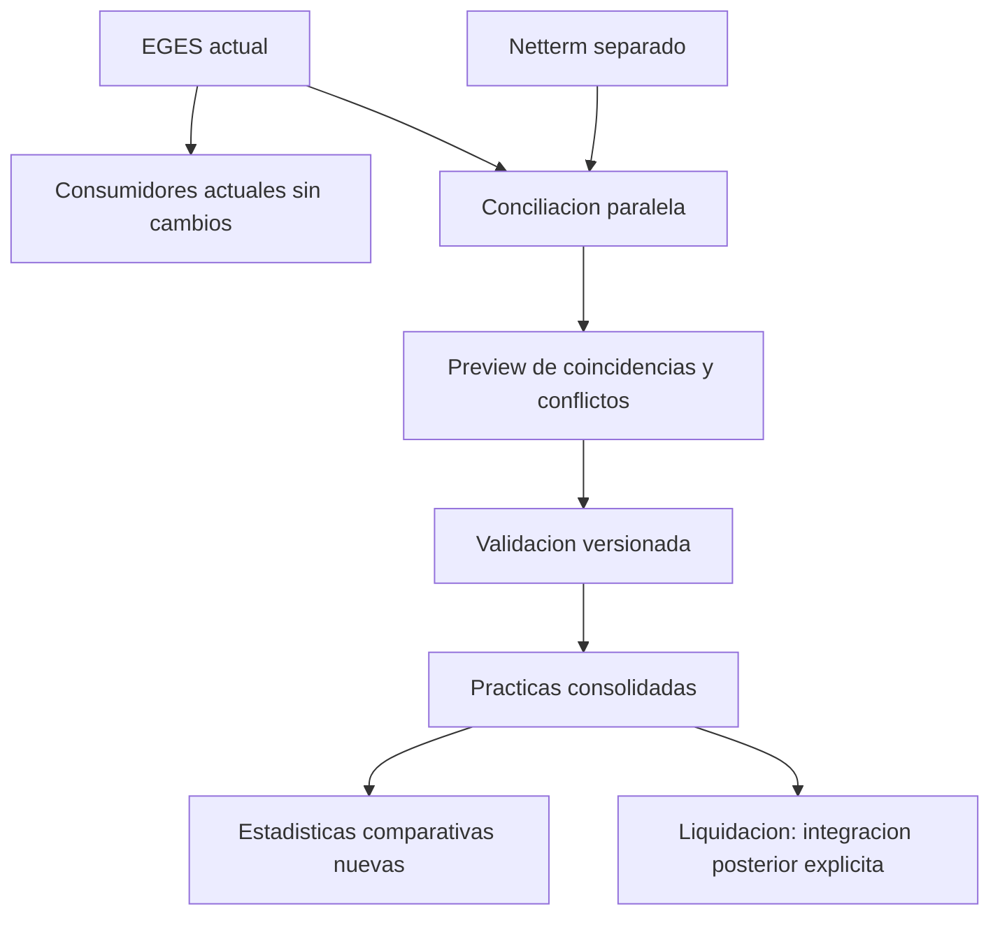

# Importacion y conciliacion EGES / Netterm

Fecha: 2026-11-06.
Estado: fases 1 y 2 implementadas localmente; fases 3 a 5 pendientes.

## Objetivo y limites

Ampliar la cobertura de estudios para estadisticas y auditoria incorporando
Netterm, sin alterar los resultados actuales de EGES ni los montos de Liquidacion.
La primera entrega incluyo el mapa de dependencias y el contrato de datos.
La fase 1 agrega un lector y preview separado; no incluye migracion de
consumidores, importaciones productivas, almacenamiento clinico ni recalculos.

Hipotesis de riesgo verificable: insertar filas Netterm en `EgesRow` cambiaria
automaticamente consultas que hoy asumen estados, fechas y tipos de atencion EGES.
Por eso Netterm debe entrar por un lector y almacenamiento de origen separados.

## Mapa de dependencias actual

| Superficie | Fuente actual | Contrato a preservar |
| --- | --- | --- |
| [Carga y validacion](../../eges_import/forms.py) | Excel EGES XLS/XLSX | Encabezados minimos EGES, limites de archivo y errores de formato. |
| [Entrada HTTP](../../eges_import/views.py) | `ImportBatch`, formulario, parser de servicios | Huella de archivo, rechazo de reimportacion exacta, resultados y navegacion del lote. |
| [Parser y consultas](../../eges_import/services.py) | `EgesRow` | Tipado de fechas/horas, clasificacion de modalidad, insumos y deduplicacion. |
| [Lotes y metricas](../../eges_import/models.py) | `ImportBatch.filas` | Finalizado = estado `Informado`; ingresos distintos por HC, fecha, hora y centro. |
| [Dashboards y endpoints](../../eges_import/urls.py) | Consultas globales y por lote | KPIs, modalidades/submodalidades, franjas, productividad, coberturas, practicas y comparativas. |
| Portal del director | Vistas y servicios de `eges_import` | Acceso por token, filtros, agregados y exportaciones; no ampliar acceso a datos individuales. |
| Exportaciones Excel/PDF | Vistas de `eges_import` | Misma poblacion, periodo y filtros que el indicador mostrado. |
| [Cruces de Liquidacion](../../liquidacion/services_eges.py) | Lote EGES, fecha, DNI/HC, practicas y profesional | Preview, revision, controles versionados y ajustes explicitos; importar no aplica montos. |
| [Evidencia economica](../../liquidacion/models.py) | FK a lote/fila EGES e historial | Preservar identidad, fingerprint y snapshots; no reemplazar filas historicas. |
| [Reversiones](../../liquidacion/services_reversiones.py) | Historial de correcciones y revisiones | Restauracion explicita, nunca borrado del historial. |
| Reclasificacion y diagnosticos | Management commands EGES y scripts locales | No ejecutar sobre Netterm ni consolidacion por el solo hecho de ampliar la carga. |

Este mapa identifica dependencias del codigo, no certifica el estado de una base
productiva. Antes de migrar una pantalla se deben comprobar sus queries y tests
concretos. Las funciones parser legadas de `views.py` no se refactorizan como
efecto lateral de agregar Netterm; la entrada activa debe verificarse por llamada.

Verificacion de la entrada activa: `importar_eges()` llama a
`_procesar_excel_eges`, alias importado de `eges_import.services.procesar_excel_eges`.
La carga web actual exige superusuario. La funcion homonima que permanece en
`views.py` no es el parser llamado por esa entrada.

Dependencias indirectas a preservar: controles/revisiones EGES alimentan el
checklist de cierre de Liquidacion; el cambio de origen no debe resolver ni reabrir
esos pendientes por si solo. En la busqueda de referencias explicitas a modelos
EGES, no se encontraron otros consumidores de runtime fuera de `eges_import` y
`liquidacion`; esto no sustituye una prueba de integracion al migrar consumidores.

## Contrato que EGES mantiene

- `ImportBatch` y `EgesRow` siguen representando exclusivamente datos EGES.
- La clave actual de fila es HC + fecha + hora + centro + practica, global entre
  lotes; no contiene el batch. Cambiarla requiere una tarea independiente.
- El importador omite insumos; no es hoy un archivo crudo completo de cada Excel.
- `archivo_sha256` identifica el contenido del archivo, no al estudio clinico.
- Los selectores de finalizados usan `Informado`; RX sin informe tiene un circuito
  propio (`Entregado Sin Informe`). No equiparar automaticamente otros estados.
- Los KPIs principales cuentan `id` de fila, no suman `cantidad`. No presentar
  una cifra consolidada como comparable hasta fijar la misma unidad de conteo.
- Los periodos existentes basados en `fecha_turno` no pasan a fecha de pedido,
  realizacion o informe sin una migracion explicita del consumidor.
- Historicos contables y controles EGES existentes no se actualizan por importar.

Limitacion actual: la deduplicacion global omite una fila con la misma clave aunque
una exportacion posterior cambie su estado o informante. Ademas, un lote nuevo
parcialmente repetido contiene solo las filas nuevas, no necesariamente la foto
completa del Excel. No usarlo como snapshot completo de periodo en la conciliacion
sin advertir esta diferencia. No se corrige ese comportamiento legacy en esta fase.

## Evidencia de los libros Netterm analizados

Analisis de lectura de los dos XLSX de octubre compartidos por el usuario; no se
incluyen documentos, nombres, pedidos ni otras claves reales en este documento.

| Observacion | ECO | Doppler |
| --- | ---: | ---: |
| Filas validas identificadas | 4010 | 562 |
| Duplicados exactos | 0 | 0 |
| Duplicados por pedido + tipo/codigo nomenclador | 0 | 0 |
| Filas con fecha de realizacion en noviembre | 13 | 15 |
| Filas con fecha de informe en noviembre | 176 | 15 |

Los dos libros no comparten pedido + nomenclador. Compartir paciente o fecha no
prueba duplicacion: hay ocho claves compartidas por documento + fecha de pedido +
codigo, pero con pedidos diferentes. Los nombres de los libros no definen modalidad:
ambos incluyen ecocardiografia y el libro ECO tambien incluye Doppler.

Se detectaron filas de internacion exclusivas de Netterm frente al EGES recibido.
No se demostro que Netterm contenga todo EGES ni que las exportaciones tengan el
mismo universo o fecha de corte. El reemplazo de EGES no esta aprobado.

## Contrato propuesto para Netterm

1. **Lote de origen:** fuente NETTERM, hash, nombre del archivo, usuario, fecha de
   importacion, version del parser, hoja, periodo declarado y periodo observado.
   Estado del lote separado de los estados clinicos.
2. **Fila de origen:** numero de fila y valores originales, incluida toda columna
   sin titulo, mas valores normalizados. Conservar ceros de identificadores y
   errores de conversion; no sustituir un dato invalido por un valor inventado.
3. **Identidad:** pedido + tipo de nomenclador + codigo es una clave candidata por
   fuente. Si se repite, clasificar como repeticion, actualizacion o conflicto;
   no borrar automaticamente. `NRO.VISUAL` es opcional, no clave universal.
4. **Fechas distintas:** guardar pedido/hora, realizacion/hora e informe/hora por
   separado. La columna sin titulo siguiente a una fecha requiere un mapeo
   posicional versionado, validado contra encabezado y tipo de celda.
5. **Estados distintos:** conservar el texto original y mapear a estados separados
   de realizacion, informe y anulacion. `INFORME DEFINITIVO` no se almacena como
   `Informado` en una fila EGES. No inferir elegibilidad economica del estado solo.
6. **Profesionales:** solicitante, informante, tecnico, operador y autor de anulacion
   son roles distintos. No pagar al solicitante ni completar el informante con el
   operador. Nombres truncados o ambiguos requieren vinculacion revisable.
7. **Cantidad:** estos libros no aportan una columna `Cantidad` equivalente a EGES.
   Una fila no autoriza a inventar cantidad economica o bilateralidad. Mantener
   cantidad desconocida hasta definir y probar la semantica de la exportacion.
8. **Clasificacion:** separar ECO general, Doppler y ECOCAR por codigo/catalogo y
   nombre, nunca por nombre del archivo. Sector, marca A/I, urgencia y tipo de
   atencion no son sinonimos; conservarlos antes de aprobar equivalencias.
9. **Codigos:** conservar el nomenclador original. `180112` y `180112/0` pueden ser
   candidatos a equivalencia; no eliminar sufijos o tipos distintos sin una regla
   explicita. Una tabla de equivalencias debe poder tener vigencia y version.
10. **Seguridad:** mismas restricciones de acceso que datos clinicos comparables,
    previews sin PHI en logs, archivos fuera de Git y politica de retencion/borrado
    definida antes de guardar originales con datos personales.

## Conciliacion propuesta

La unidad consolidada es una practica, no un paciente, pedido completo ni informe.
Cada practica puede referenciar varias evidencias originales y varias versiones
del mismo registro. La identidad consolidada no depende de la hora usada para pagar.

- Buscar candidatos por documento tipado/HC compatible, codigo equivalente y fechas
  semanticamente compatibles; no usar nombre de paciente como identificador unico.
- Distinguir `COINCIDENTE`, `SOLO_EGES`, `SOLO_NETTERM`, `AMBIGUO` y `CONFLICTO`.
  Estos resultados de matching son diferentes del estado de validacion humana.
- No vincular automaticamente dos pedidos distintos ni practicar un many-to-many
  implicito para hacer desaparecer discrepancias de cantidad.
- Guardar regla/version de matching, campos comparados, discrepancias y decision
  de revision con actor, fecha y motivo. Reanalizar no debe borrar decisiones previas.
- Conservar cada fecha y cada rol profesional: una preferencia por campo no puede
  convertir todo Netterm en dato EGES ni rellenar horas faltantes silenciosamente.
- Mismo archivo reimportado: no duplica filas. Exportacion posterior: incorpora
  evidencia de cambios de estado/informe, sin contar otra vez la misma practica.

## Plan incremental y gates

| Fase | Entrega | Riesgo / esfuerzo relativo | Gate para avanzar |
| --- | --- | --- | --- |
| 0, este documento | Mapa, contrato y limites | Bajo / bajo | Revision del alcance; ninguna query existente cambia. |
| 1 | Parser Netterm y preview transitorio anonimizables | Bajo / medio | Headers/hojas reales, fechas/horas, errores por fila y clasificacion testeados; sin escrituras clinicas o economicas. |
| 2 | Almacenamiento separado de origen | Medio / medio | Permisos, retencion, atomicidad, reimportacion exacta y nueva exportacion con actualizaciones probados; EGES intacto. |
| 3 | Conciliacion y revision | Medio / alto | Casos ambiguos, cantidades, multiples pedidos, anulaciones y decisiones versionadas cubiertos; sin publicar cifras finales por defecto. |
| 4 | Estadisticas consolidadas opt-in | Medio / medio | Comparar poblacion/periodo contra EGES; etiqueta de fuente; rollback por consumidor sin borrar datos. |
| 5 | Integracion contable | Alto / alto | Reglas de profesional, cantidad y hora aprobadas; preview, permisos, snapshots y reversion; ninguna escritura automatica al importar. |

### Criterios de no regresion

- Los mismos fixtures EGES producen los mismos lotes, filas, KPIs, exportaciones y
  resultados de cruces antes y despues de agregar el parser Netterm.
- Subir un libro Netterm no altera filas EGES, metricas existentes, montos,
  revisiones, estado de sesiones ni snapshots RRHH.
- Un archivo mixto no se duplica al importarlo en dos libros ni por reintento.
- Estadisticas futuras explicitan fecha eje (pedido, realizacion, informe), estado
  incluido y unidad (filas, practicas, cantidades, pacientes o ingresos).
- Diferenciar desconocido de cero y provisional de validado. Practica realizada,
  informe definitivo y derecho a cobro son tres decisiones distintas.
- No se cambia produccion ni se prueban archivos reales contra su base. Fixtures
  sinteticos en tests y libros reales solo en entorno aislado con limpieza final.

### Casos minimos del primer parser

- Libro ECO y libro Doppler de 37 columnas; hoja vacia adicional ignorada.
- Encabezados repetidos/vacios de horas: mapeo por posicion validado, nunca por
  un diccionario que pise todas las columnas sin titulo.
- Filas vacias o no clinicas identificadas, sin convertirlas en estudios.
- Pedido de octubre con realizacion/informe de noviembre conserva las tres fechas.
- Documento, codigo o cantidad ausentes quedan desconocidos y generan advertencia.
- Mismo paciente/fecha/codigo con pedidos distintos queda como posible coincidencia,
  no duplicado confirmado; el parser no hace conciliacion ni elimina evidencia.
- Reportar conteos por estado, modalidad y errores sin pacientes ni nombres en logs.

### Verificacion por fase

Parser EGES y endpoints: `python manage.py test eges_import --verbosity=1`.
Si una fase toca un consumidor de Liquidacion, leer antes sus instrucciones y
ejecutar sus tests focales de cruce, jornada u horario segun el alcance.
Si toca modelos: `python manage.py makemigrations --check --dry-run`.
Una fase solo documental se verifica con diff y enlaces locales, no requiere Django.

## Decisiones antes de implementar persistencia o consolidacion

- Confirmar significado de las marcas A/I y de cada hora de Netterm con el origen;
  no reemplazar `Hora Desde` EGES por hora de pedido o realizacion.
- Acordar si el indicador principal mide realizados o informados y que fecha usa.
- Confirmar unidad/cantidad de fila Netterm, posibles repeticiones de codigo dentro
  de un pedido y semantica de anulacion/reemplazo.
- Definir como se resuelve un profesional ausente o truncado y quien valida.
- Aprobar retencion del archivo/fila cruda, permisos y politica de rectificaciones.
- Definir si los estudios solo Netterm de internacion se publican tras validacion;
  su ingreso a estadisticas no habilita automaticamente liquidacion.

## Fase 1 implementada

- Lector: [services_netterm.py](../../eges_import/services_netterm.py),
  `preparar_preview_netterm`, version `NETTERM_37_V1`. No consulta modelos.
- Acceso: superusuario, desde Importar EGES -> Netterm / Vista previa,
  `/eges/netterm/preview/`. Formulario y endpoint separados del importador EGES.
- Un libro XLSX por peticion, 37 columnas en orden original; no acepta XLS legacy
  ni un Excel EGES presentado como Netterm. Limites: 10 MB comprimidos, 100 MB
  expandidos y 20000 filas. Rechaza exceso de filas en vez de recortar silenciosamente.
- Conserva valores originales en el resultado transitorio del parser; normaliza
  fechas/horas por posicion, roles y estados separados. Cantidad permanece desconocida.
- Filas vacias/encabezados repetidos se omiten; formulas y filas sin clave suficiente
  generan advertencia sin copiar valores personales al mensaje. Claves repetidas
  se marcan pero no se borran ni se concilian con otros libros.
- La pantalla recibe solo agregados, periodos, version/hash y hasta 100 ubicaciones
  de advertencias; conserva el conteo completo. No muestra pacientes, documentos o
  profesionales y no retiene las filas en la sesion del usuario.
- No crea `ImportBatch`, `EgesRow`, registros contables, revisiones ni tablas nuevas.
  Django puede usar su upload temporal normal durante la peticion; no hay almacenamiento
  aplicativo del archivo ni del resultado al finalizarla.
- Faltantes o valores invalidos se conservan como desconocidos, no como cero. La
  clasificacion por nombre es provisional, no reemplaza el catalogo ni valida cobro.

### Verificacion de la fase 1

Tests sinteticos en [eges_import/tests.py](../../eges_import/tests.py): parser sin
acceso a DB, permisos, formulas, periodos distintos, duplicados, limites, estado
vacio, archivo invalido y ausencia de escrituras en EGES/Liquidacion.
Ejecutar `python manage.py test eges_import --verbosity=1` como gate de no regresion.

Lectura de los libros reales sin importacion: 4010 filas identificables y dos
omitidas en ECO; 562 en Doppler. Cero claves de pedido/nomenclador repetidas dentro
de cada libro. Conservadas las realizaciones e informes de noviembre. El preview
advierte informantes ausentes y no intenta asignarlos por semejanza.

QA visual con SQLite temporal y workbook sintetico: login, estado inicial, error
de encabezado, recuperacion con archivo valido, resultado agregado, contraste y
desktop/mobile. No hay desbordamiento del documento a 390 px de viewport; las
tablas usan scroll propio. El servidor y los datos temporales se eliminan al terminar.

## Fase 2 implementada

Decision del usuario: conservar filas originales y normalizadas sin almacenar el
XLSX. Las versiones se conservan sin borrado automatico; una eliminacion requiere
solicitud explicita y procedimiento controlado. No se agrega un endpoint de borrado.

- Modelos separados [NettermLote y NettermFila](../../eges_import/models.py),
  migracion `0010_nettermlote_nettermfila`. No altera tablas EGES ni Liquidacion.
- Lote: hash unico del archivo, version del parser, autor, fecha, motivo, resumen
  y ubicaciones limitadas de advertencias. Se crea completo en una transaccion.
- Fila: ubicacion original, 37 valores originales con tipo y valor serializados,
  normalizados, fechas distintas, estado y huellas de contenido/clave candidata.
  La clave candidata es pedido + tipo de nomenclador + codigo, no paciente/fecha.
- Clases de observacion: NUEVA, REITERADA, ACTUALIZADA y AMBIGUA. La referencia
  previa solo se vincula si existe una observacion inequivoca en el ultimo lote de
  esa clave y su documento/HC coincide. Claves repetidas, identidad dudosa o
  ambiguedad previa permanecen ambiguas; importar no las resuelve.
- No existe todavia una entidad consolidada de estudio. Dos libros pueden conservar
  evidencias repetidas sin que esas filas se sumen a indicadores finales. Los conteos
  NUEVA/ACTUALIZADA describen observaciones de importacion, no validacion clinica.
- Cada exportacion es un snapshot separado, no un delta que sobrescriba el anterior.
  Una observacion anterior que no aparezca en un libro posterior no se elimina ni
  se considera anulada por ausencia. Las referencias describen lo observado al
  importar; no son una resolucion definitiva de identidad entre fuentes.
- Los modelos bloquean sobrescrituras mediante `save`; no se registran como modelos
  editables en admin. Scripts/SQL privilegiados deben respetar la politica de origen
  inmutable; no hay triggers de inmutabilidad en esta fase.

### Flujo de uso de fase 2

1. Superusuario abre Importar EGES -> Netterm / Vista previa.
2. Selecciona el XLSX y revisa agregados, fechas y advertencias; el preview no guarda.
3. Para guardar, vuelve a seleccionar el mismo archivo, ingresa un motivo y marca
   la confirmacion. Esta segunda seleccion evita retener el archivo o PHI en sesion.
4. El token firmado dura 15 minutos y contiene solo usuario, hash y version del
   parser. El servicio relee el XLSX y rechaza cambios respecto al preview.
5. Se muestra el lote en `/eges/netterm/lotes/`. Un archivo identico devuelve el
   lote existente sin duplicar filas. Un fallo al guardar filas revierte todo el lote.

Las rutas de guardado y listado tambien requieren superusuario. Guardar solo acepta
POST y exige confirmacion y motivo. El listado muestra metadatos de lotes y conteos,
no documentos, nombres de pacientes ni contenido clinico de las filas archivadas.
No hay archivo XLSX descargable porque no se conserva en servidor.

### Validacion de fase 2

Pruebas sinteticas: idempotencia, cambio de estado sin perder snapshot previo,
contenido reiterado, claves/documentos ambiguos, persistencia de ambiguedad, rechazo
de sobrescrituras, rollback ante fallo, tokens alterados/vencidos/de otro usuario,
archivo cambiado y confirmacion obligatoria. Las suites EGES existentes siguen
incluidas en `python manage.py test eges_import --verbosity=1`.

QA visual: libro pendiente sintetico y exportacion definitiva posterior guardados
en SQLite temporal; ambas observaciones permanecen, la segunda referencia a la
primera. Verificado desktop/mobile, sin overflow de pagina; tablas con scroll propio.
Se comprobaron cero filas/lotes EGES, registros contables y sesiones en la base QA.
Servidor y carpeta temporal eliminados; ninguna migracion aplicada a la base local.
La concurrencia especifica de PostgreSQL no se ejecuto en SQLite: el hash unico y
`get_or_create` protegen la reimportacion exacta, pero los cruces/decisiones finales
de identidad de importaciones simultaneas pertenecen a la fase de conciliacion.

Siguiente fase: conciliacion y revision versionada contra EGES, con preview de
coincidencias, exclusivos, ambiguos y conflictos. Dashboards y Liquidacion siguen
sin consumir filas Netterm.