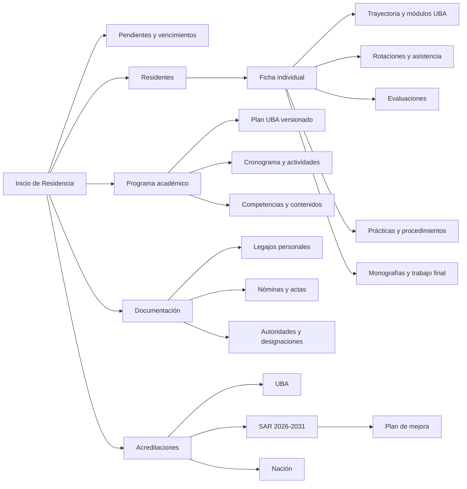

# Gestión integral de la residencia - alcance y arquitectura

Estado: propuesta con base normativa parcial, pendiente de validación institucional

Fecha: 27/09/2026

## 1. Objetivo

Crear una aplicación de gestión académica y documental para la residencia de
Diagnóstico por Imágenes del Sanatorio Colegiales. Debe permitir que la persona
responsable de la residencia conozca, en una sola pantalla:

1. qué documentación personal e institucional está completa, faltante o vencida;
2. qué obligaciones académicas corresponden a cada residente y ciclo;
3. qué rotaciones, evaluaciones, asistencias y procedimientos están cumplidos;
4. qué trámites, actas, nóminas y cierres deben presentarse ante UBA o SAR;
5. qué evidencia respalda cada dato y quién lo validó.

El sistema será una herramienta interna de gestión. No reemplazará los sistemas
oficiales de UBA o SAR ni afirmará cumplimiento normativo sin validación humana.

## 2. Diagnóstico del sistema actual

La residencia ya dispone de piezas valiosas, pero no de un orquestador académico:

| Responsabilidad | Fuente actual | Decisión |
|---|---|---|
| Identidad, rol, R1-R4 y estado | `accounts.CustomUser` | Reutilizar como fuente canónica de personas. |
| Actividad longitudinal y evidencias | `portafolio` | Reutilizar como vista del residente y repositorio de actividad curricular. |
| Exámenes y calificaciones | `evaluaciones_residentes` | Referenciar resultados publicados; no copiar notas. |
| Clases y materiales | `clases_residentes` | Referenciar actividad; no duplicar archivos. |
| Guardias y ausencias operativas | `control_guardias` | Consumir resultados; no gestionar guardias desde la nueva app. |
| Preinformes y revisión docente | `preinformes` | Consumir indicadores sin texto clínico ni datos de pacientes. |
| Producción asistencial agregada | `liquidacion` | Consumir cantidades permitidas, nunca datos económicos o de pacientes. |
| Protocolos | `protocolos` | Mantener como biblioteca clínica, no como evidencia automática de competencia. |

Faltan programa formativo versionado, legajo documental, rotaciones académicas,
asistencia, competencias, logbook de procedimientos, actas, trámites y cierre
anual inmutable.

## 3. Marco normativo relevado

### 3.1 UBA - prioridad principal

Información oficial consultada el 27/09/2026:

- La Carrera de Médico Especialista en Diagnóstico por Imágenes dura cuatro años
  y se rige por la Resolución CS 7746/2017.
- El plan específico tiene 7500 horas: 1500 teóricas y 6000 prácticas. Se organiza
  en cuatro módulos de 1875 horas cada uno. El Módulo I es correlativo obligatorio
  de los Módulos II, III y IV; estos tres se dictan alternativamente durante los
  años restantes y no tienen orden obligatorio entre sí.
- El Módulo I reúne física de bioimágenes, introducción a la especialidad,
  radiofísica y radioprotección, medios de contraste, anatomía y técnicas de
  examen, emergentología y metodología de la investigación.
- Los Módulos II a IV cubren las áreas osteoarticulomuscular, respiratoria,
  cardiovascular y Doppler, digestiva, urinaria y retroperitoneal, mama,
  ginecoobstetricia, medicina legal, intervencionismo, neuroimágenes, columna,
  medicina nuclear, región cervicomaxilofacial, endocrinología y pediatría.
- Las prácticas incluyen rotaciones por las modalidades del Servicio, actividad
  en internación y quirófano, participación supervisada en informes,
  interconsultas, ateneos y acceso a recursos bibliográficos.
- La Sede debe documentar las prácticas y destrezas de cada alumno. El modelo
  UBA distingue fecha, práctica/procedimiento, ámbito o rotación, supervisor,
  resultado, observaciones y rol del alumno.
- Para mantener regularidad y promover se exige 80% de asistencia, aprobación de
  los exámenes teórico-prácticos e integradores de cada módulo y nota mínima 7/10.
- Para graduarse se exige aprobar los cuatro módulos, cuatro monografías anuales,
  las prácticas y procedimientos requeridos y el trabajo final individual
  integrador, con defensa oral opcional.
- Sanatorio Colegiales figura en la oferta UBA 2026 como unidad académica, con
  tres vacantes de ingreso automático y dirección informada por UBA.
- El ingreso exige título de médico, DNI, seguro de mala praxis, acreditación del
  sistema de formación en servicio y antecedentes; títulos no UBA o extranjeros
  requieren legalización, registro y, cuando corresponda, reválida o conválida.
- Para ingreso automático también se solicitan certificado de residencia,
  seguro personal/ART, matrícula y nómina emitida por la dirección de la sede.
- La sede debe conservar y presentar nóminas de ingresantes y actas. La situación
  académica depende de que las actas estén cargadas correctamente.
- La regularidad puede perderse por dos años sin rendir, por no aprobar el trabajo
  final integrador dentro de los dos años posteriores a la última asignatura, por
  no aprobar al menos el 80% del ciclo anterior o por perder la condición de
  residente, concurrente o becario.
- La Resolución RESCS-2026-316-E-UBA-REC reemplaza desde el año académico 2026
  el marco general aprobado por la Resolución CS 4030/2015 y sus modificatorias.
- Al ser una carrera asistencial, el programa debe identificar carga teórica y
  práctica, correlatividades, promoción, permanencia, objetivos, contenidos,
  evaluación, graduación y prácticas supervisadas con responsabilidad creciente.
- Como mínimo general para especializaciones asistenciales básicas, UBA establece
  1760 horas anuales, 80% prácticas, 20% teóricas y 40 horas semanales. El plan
  específico de Diagnóstico por Imágenes puede establecer exigencias mayores.
- El Director debe informar los ingresantes dentro de los 60 días hábiles desde
  el inicio y las vacantes deben comunicarse con seis meses de anticipación.
- Cada asignatura requiere al menos 80% de asistencia y evaluación final aprobada.
  También deben existir evaluaciones continuas e integrativas, evaluación final
  de competencias y trabajo final individual integrador.
- La carrera se evalúa académicamente cada cinco años y la Sede puede ser
  auditada en cualquier momento en sus dimensiones teórica, práctica, evaluativa
  y administrativa.
- UBA advierte que los planes están en actualización. Toda regla curricular debe
  guardar institución, resolución, versión y vigencia, sin quedar fija en código.

Las Resoluciones 7746/2017 y 316/2026 ya fueron aportadas y revisadas. El plan
2017 sigue siendo la fuente específica disponible, sujeto a las modificaciones
generales vigentes desde 2026 y a cualquier actualización posterior que informe
UBA. Antes de publicar reglas en producción debe confirmarse con la Sede que no
exista una modificación específica más reciente.

### 3.2 SAR

Información oficial consultada el 27/09/2026:

- El dictamen SAR del 07/08/2026 reacredita al Servicio de Diagnóstico por
  Imágenes de Sanatorio Colegiales como Centro de Enseñanza. Declara un período
  de cinco años y expresa la vigencia como agosto de 2026 a diciembre de 2031.
  Esta última fecha debe conservarse como vencimiento documental y la renovación
  debe iniciarse, como máximo, en junio de 2031.
- El Curso Superior SAR exige ser médico, residente en un centro acreditado y
  socio SAR; solicita CV, título, promedio, DNI y certificado de residencia.
- La acreditación del centro requiere carta del responsable académico,
  habilitación, Instrumento de Evaluación de Residencias y documentación anexa.
- El proceso contempla revisión documental, entrevista, visita y dictamen. La
  acreditación puede ser denegada, provisoria o temporal por dos a cinco años.
- La reacreditación debe iniciarse al menos seis meses antes del vencimiento.

El dictamen exige que la próxima renovación incluya un informe detallado y
documentación respaldatoria sobre el cumplimiento de estas recomendaciones:

1. formación progresiva y participación en proyectos de investigación;
2. trabajos en congresos y publicaciones con participación de todos los residentes;
3. capacitación pedagógica del equipo docente;
4. recertificación periódica de los médicos de planta;
5. programa teórico anual con participación docente equilibrada, evitando que la
  carga recaiga mayoritariamente en residentes;
6. evaluación periódica de docentes con fortalezas y oportunidades de mejora;
7. rotación complementaria en imágenes pediátricas.

Estas recomendaciones conforman un plan de mejora institucional SAR 2026-2031.
No son requisitos individuales de graduación salvo que una norma o programa
posterior los incorpore expresamente. Continúa pendiente incorporar como fuentes
controladas el reglamento, programa e Instrumento de Evaluación SAR vigentes.

### 3.3 Ministerio de Salud de la Nación

La Disposición DI-2019-75-APN-SSCRYF#MSYDS acreditó a la residencia de
Diagnóstico por Imágenes de Sanatorio Colegiales en Categoría C por dos años
desde su publicación del 19/07/2019. Ese período finalizó en 2021: constituye un
antecedente y una fuente de hallazgos, no evidencia de acreditación nacional
vigente. Debe solicitarse el acto posterior de reacreditación, si existe.

La evaluación fue realizada por SAR con el Instrumento Nacional y ordenó:

- adecuar programa, contenidos, escenarios y contenidos transversales;
- incluir Resonancia Magnética desde R1;
- formalizar convenios de rotaciones externas;
- adecuar y distribuir uniformemente la carga de guardias;
- sistematizar prácticas y procedimientos por residente, sede y rotación;
- formalizar evaluaciones de competencias con instrumentos diversos;
- garantizar formación teórico-práctica sin costo adicional;
- incorporar metodología, actividades y producción de investigación;
- promover formación y asesoramiento pedagógico del equipo docente;
- informar anualmente residentes activos y egresados;
- iniciar la nueva acreditación seis meses antes del vencimiento.

El documento nacional de 2023 `Programa de Residencia - Componentes esenciales`
define nueve componentes mínimos: carátula, fundamentación, perfil del egresado,
objetivos por año, contenidos por año, escenarios de enseñanza, recursos,
cronograma de rotaciones y sistema de evaluación. Este último debe contemplar,
como mínimo, evaluación anual integradora, post-rotación y final, todas de
carácter teórico-práctico.

### 3.4 Matriz de trazabilidad normativa

| Regla | Fuente | Impacto mínimo en el sistema |
|---|---|---|
| Vigencia desde ciclo 2026 | RESCS-2026-316, art. 2 resolutivo | Versionar requisitos por ciclo y no recalcular históricos. |
| Diseño curricular completo | RESCS-2026-316, arts. 5-6 | Programa, actividades, horas, correlativas, evaluación y graduación versionados. |
| Sede, Subsede y Centro de Práctica | RESCS-2026-316, arts. 7-11 | Modelar instituciones, dependencia única, convenios, informes y rotaciones. |
| Autoridades y mandatos | RESCS-2026-316, arts. 12-19 | Cargos con designación, aval, inicio, fin, renovación y suplencia. |
| Legajo de inscripción | RESCS-2026-316, arts. 20-23 | Checklist condicional por procedencia y modalidad de admisión. |
| Declaración jurada y autenticidad | RESCS-2026-316, art. 22 | Aceptación registrada, hash, versiones e incidente documental auditable. |
| Nómina de ingreso en 60 días hábiles | RESCS-2026-316, art. 23 | Vencimiento calculado, responsable, evidencia de envío y recepción. |
| Vacantes con seis meses de anticipación | RESCS-2026-316, art. 27 | Plan anual de vacantes y alerta institucional. |
| Regularidad y reincorporación única | RESCS-2026-316, arts. 29-31 | Motor explicable de alertas, expediente y decisión humana; no baja automática. |
| 80% de asistencia por asignatura | RESCS-2026-316, art. 30 | Asistencia por actividad/asignatura y denominador auditable. |
| Licencias y plan de cumplimiento | RESCS-2026-316, art. 32 | Licencia protegida y plan individual sin penalización automática. |
| Evaluación y trabajo final | RESCS-2026-316, art. 33 | Evaluaciones continuas/integrativas, competencias y trabajo final. |
| Evaluación quinquenal y auditoría | RESCS-2026-316, arts. 35-37 | Expediente de autoevaluación, evidencias de sede y plan de mejora. |
| Duración y carga específica | CS 7746/2017, anexo V.B | Cuatro años, 7500 horas, 20% teóricas y 80% prácticas. |
| Plan modular y correlatividad | CS 7746/2017, anexo V.B | Cuatro módulos; Módulo I obligatorio antes de II, III y IV. |
| Promoción por módulo | CS 7746/2017, anexo VI.d | Examen integrador, escala 0-10, aprobación con 7 y promoción anual. |
| Producción académica | CS 7746/2017, anexo VI.d-e | Cuatro monografías y trabajo final individual integrador. |
| Prácticas documentadas | CS 7746/2017, anexo V.B | Logbook con ámbito/rotación, rol, supervisor, resultado y observaciones. |
| Actividades prácticas | CS 7746/2017, anexo V.B | Rotaciones por modalidades, informes, ateneos, interconsultas e investigación. |
| Reacreditación SAR vigente | Dictamen SAR 07/08/2026 | Vigencia documental hasta diciembre de 2031 y alerta de renovación en junio de 2031. |
| Plan de mejora SAR | Dictamen SAR 07/08/2026 | Siete líneas de mejora con responsables, acciones, evidencia, avance e informe final. |
| Rotación pediátrica complementaria | Dictamen SAR 07/08/2026, rec. 7 | Planificar rotación y documentar sede, objetivos, asistencia, evaluación y convenio. |
| Desarrollo y evaluación docente | Dictamen SAR 07/08/2026, recs. 3-6 | Formación pedagógica, recertificación, participación docente y evaluación periódica. |
| Logbook supervisado | DI-2019-75, art. 2.g | Prácticas y procedimientos por residente, sede/rotación y supervisor. |
| Evaluaciones mínimas nacionales | Componentes esenciales 2023, ap. 1.9 | Instancias anual, post-rotación y final teórico-prácticas. |
| RM desde R1 | DI-2019-75, art. 2.b | Requisito trazable a confirmar en el programa vigente. |
| Reacreditación anticipada | DI-2019-75, art. 4 | Alerta seis meses antes y expediente de nueva acreditación. |

Los automatismos deben funcionar como alertas y prevalidaciones. La regularidad,
la autenticidad documental, las equivalencias y la promoción requieren decisión
de una autoridad identificada y no pueden resolverse solo por un semáforo.

### 3.5 Fuentes oficiales

- UBA, oferta 2026: `https://www.fmed.uba.ar/carreras-de-especialistas/ofertas-de-carreras-de-especializacion`
- UBA, inscripción: `https://www.fmed.uba.ar/carreras-de-especialistas/inscripcion`
- UBA, alumnos: `https://www.fmed.uba.ar/carreras-de-especialistas/alumnos-de-posgrado`
- UBA, autoridades y sedes: `https://www.fmed.uba.ar/carreras-de-especialistas/autoridades-docentes-y-personal-administrativo`
- UBA, reglamentación: `https://www.fmed.uba.ar/carreras-de-especialistas/reglamentacion`
- SAR, curso superior: `https://sar.org.ar/curso-superior-en-diagnostico-por-imagenes/`
- SAR, acreditación: `https://sar.org.ar/certificaciones/`
- SAR, centros: `https://sar.org.ar/centros-certificados/`
- SAR, dictamen de reacreditación como Centro de Enseñanza del 07/08/2026,
  dirigido al Servicio de Diagnóstico por Imágenes de Sanatorio Colegiales.
- UBA, Resolución RESCS-2026-316-E-UBA-REC, Anexo ACS-2026-51-UBA-SG#REC.
- UBA, Resolución CS 7746/2017, expediente 28.679/2017, plan de la Carrera
  de Médico Especialista en Diagnóstico por Imágenes.
- Nación, Disposición DI-2019-75-APN-SSCRYF#MSYDS:
  `https://www.argentina.gob.ar/normativa/nacional/norma-325369/texto`
- Ministerio de Salud, `Programa de Residencia - Componentes esenciales`, 2023.

## 4. Frontera de la aplicación

Nombre propuesto: `residencia_academica`.

La aplicación será dueña de:

- programas, versiones, ciclos, requisitos y competencias;
- matrícula académica del residente en cada ciclo;
- legajos documentales personales e institucionales;
- rotaciones académicas y sus evaluaciones;
- asistencia a actividades formativas;
- logbook de procedimientos con validación de supervisor;
- trámites, nóminas, actas, vencimientos y acreditaciones;
- decisiones de promoción, repetición, baja y egreso;
- snapshots de cierre y auditoría de cambios.

No será dueña de usuarios, guardias, exámenes existentes, preinformes, estudios,
liquidaciones, clases o protocolos. Los integrará mediante selectores públicos.

## 5. Modelo conceptual

### Núcleo normativo

- `InstitucionReguladora`: UBA, SAR u otra autoridad futura.
- `Normativa`: resolución, reglamento, instrumento o instructivo con URL,
  archivo privado, fecha de consulta, vigencia y estado de validación.
- `ProgramaFormativo`: Diagnóstico por Imágenes y organismo que lo regula.
- `VersionPrograma`: resolución, duración, vigencia y estado borrador/publicado.
- `ComponentePrograma`: fundamentación, perfil, objetivos, contenidos, escenarios,
  recursos, rotaciones y evaluación, con responsable y estado de revisión.
- `RequisitoPrograma`: obligación documental, académica, asistencial o de egreso,
  aplicable a ingreso, R1-R4, cierre o acreditación de sede.
- `Competencia` y `RequisitoCompetencia`: resultados esperados y evidencia válida.
- `ActividadCurricularPrograma`: asignatura o actividad, año, horas teóricas y
  prácticas, modalidad, correlatividades y criterio de aprobación.
- `ModuloPrograma`: orden/ciclo, carga teórica y práctica, correlatividades y
  regla de promoción. La versión 2017 contiene cuatro módulos de 1875 horas.
- `ContenidoCurricular`: tema mínimo asociado a una actividad, con fuente y
  vigencia, para actualizar el catálogo sin modificar resultados históricos.

### Trayectoria

- `CicloAcademico`: fechas institucionales únicas y estado.
- `MatriculaResidencia`: residente, cohorte, ciclo, año, modalidad de ingreso,
  condición y sede. Congela los datos históricos que hoy dependen del perfil.
- `Rotacion` y `AsignacionRotacion`: área, institución, fechas, tutor, objetivos,
  obligatoriedad, convenio, asistencia, informe y resultado.
- `RegistroAsistencia`: actividad programada, fecha, carga horaria,
  presente/ausente/justificado y validador. El porcentaje conserva numerador,
  denominador y exclusiones para que el 80% sea auditable.
- `LicenciaFormativa`: tipo protegido, período, respaldo privado y plan individual
  para completar obligaciones teóricas y prácticas.
- `ProcedimientoFormativo`: modalidad, región, técnica, rol y nivel requerido.
- `RegistroProcedimiento`: residente, procedimiento, fecha, rol realizado,
  supervisor, evidencia y estado de validación. No replica identidad ni historia
  clínica del paciente; cuando sea imprescindible conciliar con una fuente
  asistencial utiliza una referencia opaca con acceso restringido.
- `EvaluacionRotacion`: instrumento, resultado, devolución y firmas.
- `InstanciaEvaluacion`: continua, integrativa, anual, post-rotación, final o de
  competencias, con escala, nota mínima, instrumento, evaluadores, resultado y
  retroalimentación.
- `ProduccionAcademica`: monografía anual u otro trabajo requerido, con ciclo,
  tutor, versión, evaluación y estado. El plan 2017 exige cuatro monografías.
- `TrabajoFinalIntegrador`: tema, tutor, hitos, presentación, defensa y aprobación.
- `DecisionAcademica`: promoción, repetición, baja, reincorporación o egreso con
  fundamento, responsables y fecha de efecto.

### Documentación y gestión

- `TipoDocumento`: organismo, alcance, obligatoriedad, vigencia y responsable.
- `DocumentoLegajo`: propietario persona/sede, archivo privado, metadatos, hash,
  emisor, vencimiento, estado, declaración jurada y validador.
- `IncidenteDocumental`: documento observado o presuntamente adulterado, medidas,
  plazo de retención del trámite y resolución por autoridad competente.
- `TramiteAcademico`: organismo, tipo, fechas, estado, responsable y expediente.
- `ItemTramite`: checklist versionado y vínculo con documentos o evidencias.
- `ActaAcademica`: ciclo, tipo, fecha, estado de presentación y archivo firmado.
- `AcreditacionSede`: organismo, vigencia, precisión de fecha (día/mes/año),
  texto original del período, resultado, expediente y alertas. No debe inventar
  un día cuando el dictamen solo informa mes y año.
- `PlanMejoraAcreditacion`: dictamen de origen, período, responsable general,
  estado, porcentaje de avance y fecha objetivo del informe de renovación.
- `AccionMejora`: recomendación, acción concreta, responsable, indicador, meta,
  fechas, estado, observaciones y evidencias privadas. Una recomendación puede
  requerir varias acciones durante distintos ciclos.
- `EvaluacionDocente`: período, instrumento, evaluador o fuente anonimizada,
  resultado agregado, fortalezas, oportunidades y plan de seguimiento. El acceso
  a respuestas individuales debe restringirse según política institucional.
- `CredencialDocente`: especialidad, entidad emisora, número opcional, vigencia y
  evidencia de certificación o recertificación del equipo formador.
- `ParticipacionDocenteActividad`: actividad teórica, docente responsable, rol y
  carga horaria, para medir la distribución sin usarla como ranking automático.
- `UnidadFormadora`: Sede, Subsede o Centro de Práctica Asistencial, dependencia,
  infraestructura, casuística, convenios y vigencia de autorización.
- `DesignacionAutoridad`: cargo, persona, resolución, avales, inicio, fin,
  renovación y reemplazo. Debe soportar reglas históricas: el plan 2017 preveía
  cinco años para Director y el reglamento general 2026 fija cuatro para nuevas
  designaciones; los demás mandatos relevantes son de dos años.
- `VacanteAcademica`: ciclo, unidad, modalidad, cantidad, fecha límite,
  comunicación y acuse de recibo.
- `AutoevaluacionSede`: período quinquenal, dimensiones, evidencias, hallazgos,
  plan de mejora y seguimiento.
- `CierreAnual`: snapshot inmutable por residente/ciclo, hash, PDF y versión del
  programa aplicada.
- `EventoAuditoria`: actor, acción, objeto, cambios, fecha e IP cuando corresponda.

Todos los archivos documentales deben usar almacenamiento privado, nombre interno
aleatorio, autorización backend y URL firmada de corta duración. Se reutilizará
el patrón ya probado por `DocumentoActividadCurricular`.

## 6. Flujos principales

### Alta de cohorte UBA

1. Docencia abre el ciclo y carga vacantes autorizadas.
2. Selecciona residentes existentes en `accounts`.
3. El sistema genera el checklist según la versión UBA vigente.
4. El aspirante confirma la declaración jurada; Docencia controla y valida los
  documentos, y el Director aprueba la nómina.
5. Se registra presentación, observaciones y aceptación de UBA, con alerta para
  cumplir los 60 días hábiles desde el inicio.
6. La matrícula cambia a activa sin modificar automáticamente el rol del usuario.

### Seguimiento mensual

1. El tablero muestra residentes y semáforos de documentación, rotaciones,
   asistencia, evaluaciones y procedimientos.
2. Cada indicador enlaza a la evidencia de origen.
3. Las tareas próximas y vencidas se asignan a una persona responsable.
4. Ningún conteo automático equivale por sí solo a competencia aprobada.
5. Las alertas de regularidad muestran cálculo, fuente y regla aplicable, pero
  requieren resolución de una autoridad académica.

### Cierre anual

1. El sistema ejecuta una prevalidación contra requisitos de la versión vigente.
2. Docencia resuelve faltantes y registra excepciones fundamentadas.
3. El comité o autoridad autorizada registra la decisión académica.
4. Se genera snapshot y documento de cierre inmutable.
5. Recién después se aplica la promoción en `accounts` mediante un servicio
   coordinado e idempotente.

### Acreditación o reacreditación SAR

1. La acreditación vigente se registra con dictamen, período y alerta de renovación.
2. Las siete recomendaciones generan un plan de mejora con acciones, responsables,
  indicadores, metas y evidencias por ciclo.
3. El tablero revisa avance y faltantes sin confundir recomendación con obligación
  individual del residente.
4. Antes de junio de 2031 se abre el trámite de renovación y se compone el informe
  detallado desde las evidencias acumuladas.
5. Se adjuntan habilitación, carta, instrumento y anexos; luego se registran
  entrevista, visita, observaciones y nuevo dictamen sin borrar períodos previos.

## 7. Roles y permisos propuestos

| Capacidad | Residente | Jefe residentes | Instructor | Director UBA | Admin. docencia | Jefe servicio | Superusuario |
|---|---:|---:|---:|---:|---:|---:|---:|
| Ver trayectoria propia | Sí | Según vínculo | Según vínculo | Sí | Resumen | Según política | Sí |
| Cargar documento propio | Sí | Sí | Sí | No | Sí | No | Sí |
| Validar documentos | No | Limitado | Sí | Sí | Control formal | Según política | Sí |
| Gestionar rotaciones/asistencia | No | Sí | Sí | Sí | Operativo | Según política | Sí |
| Validar procedimientos | No | Sí, si supervisor | Sí | Sí | No | Si supervisor | Sí |
| Gestionar trámites UBA/SAR | No | Consulta | Consulta | Sí | Sí | Según política | Sí |
| Firmar cierre o promoción | No | Propuesta | Propuesta | Sí | No | Según política | Sí |

La matriz final debe acordarse institucionalmente. Los permisos se comprobarán
en backend y deberán contemplar delegación temporal con inicio y vencimiento.

## 8. Esquema funcional y visual

### 8.1 Idea general

El módulo debe sentirse como una consola de gestión académica, no como una suma
de formularios. La pantalla inicial responde primero `¿qué requiere atención
hoy?` y desde allí permite profundizar en una persona, un ciclo o un expediente.



### 8.2 Navegación propuesta

El navbar incorporará un grupo `Residencia` visible según permisos. Dentro del
módulo se utilizarán pestañas para vistas estables y una bandeja para trabajo
pendiente.

| Entrada | Pregunta que responde | Usuario principal |
|---|---|---|
| `Inicio` | ¿Qué tengo que resolver ahora? | Director, instructor, administración |
| `Residentes` | ¿Cómo está cada trayectoria? | Equipo formador |
| `Programa` | ¿Qué debe cumplirse en este ciclo? | Director e instructor |
| `Documentación` | ¿Qué falta, vence o debe presentarse? | Administración y director |
| `Acreditaciones` | ¿Qué exige cada organismo y cómo avanzamos? | Director y administración |
| `Mi residencia` | ¿Cómo viene mi formación y qué me falta? | Residente |

No se mostrará una entrada separada para cada modelo técnico. Actas, autoridades,
vacantes o credenciales aparecerán dentro del contexto operativo correspondiente.

### 8.3 Dashboard de gestión

```text
┌──────────────────────────────────────────────────────────────────────────────┐
│ RESIDENCIA · Ciclo 2026/27                         [Cambiar ciclo] [Config.] │
│ Gestión académica y documental · Sanatorio Colegiales                       │
├──────────────────────────────────────────────────────────────────────────────┤
│ 12 residentes   7 pendientes críticos   3 documentos por vencer   SAR 2031 │
├──────────────────────────────────────────────────────────────────────────────┤
│ REQUIERE ATENCIÓN                                         [Ver todos]        │
│ 🔴 Nómina UBA R1 · vence en 8 días             Responsable: Administración │
│ 🟠 2 residentes con seguro próximo a vencer    [Revisar documentos]         │
│ 🟠 Evaluación post-rotación pendiente · R2     [Asignar responsable]        │
│ 🔵 Plan SAR: evidencia de formación docente    [Continuar]                  │
├──────────────────────────────────────────────────────────────────────────────┤
│ RESIDENTES                                                                  │
│ Buscar residente...          [Todos] [R1] [R2] [R3] [R4] [Con alertas]      │
│                                                                              │
│ Residente              Año  Documentos  Académico  Prácticas  Próximo paso  │
│ Ana Pérez              R1   Completo    82%        64%        Ver ficha  →  │
│ Juan Gómez             R2   1 faltante  Al día     78%        Resolver   →  │
│ María López            R4   Completo    TFI pend.  100%       Ver cierre →  │
├──────────────────────────────────────────────────────────────────────────────┤
│ ESTADO INSTITUCIONAL                                                        │
│ UBA: ciclo activo · nómina en preparación | SAR: vigente · plan 38%         │
│ Nación: acreditación histórica vencida · verificación pendiente             │
└──────────────────────────────────────────────────────────────────────────────┘
```

La cabecera seguirá el patrón de `portafolio`: `base_tailwind.html`, gradiente
institucional y contexto del ciclo. Debajo se usarán superficies compactas y una
tabla escaneable; no una grilla extensa de tarjetas decorativas.

### 8.4 Ficha integral del residente

```text
┌──────────────────────────────────────────────────────────────────────────────┐
│ ← Residentes   ANA PÉREZ · R2 · Ciclo 2026/27       [Registrar seguimiento] │
├──────────────────────────────────────────────────────────────────────────────┤
│ [Resumen] [Documentos] [Plan UBA] [Rotaciones] [Prácticas] [Evaluaciones]    │
│ [Producción académica] [Historial]                                           │
├──────────────────────────────────────────────────────────────────────────────┤
│ ESTADO DEL CICLO                   PRÓXIMAS ACCIONES                         │
│ Documentación       Completa       • Evaluación de rotación · 14 oct.       │
│ Asistencia          87%            • Renovar seguro · 2 nov.                 │
│ Módulo II           En curso       • Presentar monografía anual              │
│ Prácticas           142 validadas                                            │
│ Evaluaciones        2/3 aprobadas  [Ver todos los pendientes]               │
├──────────────────────────────────────────────────────────────────────────────┤
│ TRAYECTORIA                                                                   │
│ 2025/26 R1 ✓ ───────── 2026/27 R2 ● ───────── R3 ○ ───────── R4 ○           │
├──────────────────────────────────────────────────────────────────────────────┤
│ ACTIVIDAD RECIENTE                                                           │
│ 26 sep · Procedimiento validado por Dra. X                                   │
│ 21 sep · Documento observado: completar vigencia                             │
│ 18 sep · Evaluación post-rotación aprobada                                   │
└──────────────────────────────────────────────────────────────────────────────┘
```

La ficha no reemplaza el Portafolio. Presenta cumplimiento formal y enlaza a la
evidencia de origen. El Portafolio mantiene la visión longitudinal de actividad;
esta pantalla responde si la trayectoria cumple el programa aplicable.

### 8.5 Programa académico y calendario

```text
┌──────────────────────────────────────────────────────────────────────────────┐
│ PROGRAMA ACADÉMICO · UBA 7746/2017               [Vista anual] [Configurar] │
├──────────────────────────────────────────────────────────────────────────────┤
│ Módulo I ✓      Módulo II ●      Módulo III ○      Módulo IV ○              │
│ 1875 h          1875 h           1875 h            1875 h                    │
│ Correlativo     En curso         Pendiente          Pendiente                 │
├──────────────────────────────────────────────────────────────────────────────┤
│ SEPTIEMBRE 2026                                                              │
│ Lun 7  Clase: Sistema respiratorio            Docente: Dra. A   2 h          │
│ Mar 8  Ateneo interdisciplinario               Responsable: R3   1 h          │
│ Jue 10 Rotación TC                              R1/R2             6 h          │
│ Vie 11 Evaluación post-rotación                 R2                Pendiente   │
├──────────────────────────────────────────────────────────────────────────────┤
│ COBERTURA DEL PROGRAMA                                                       │
│ Teoría  34%  ███████░░░░░░░    Práctica 41% ████████░░░░░                  │
│ 3 contenidos sin actividad programada         [Revisar cobertura]           │
└──────────────────────────────────────────────────────────────────────────────┘
```

Esta vista relaciona actividades con módulos y contenidos. No se cargarán horas
solo para aumentar un porcentaje: cada registro debe tener fecha, responsable,
destinatarios y evidencia o asistencia cuando corresponda.

### 8.6 Bandeja documental

```text
┌──────────────────────────────────────────────────────────────────────────────┐
│ DOCUMENTACIÓN                                                               │
│ [Pendientes] [Por vencer] [Observados] [Presentados] [Todos]                │
├──────────────────────────────────────────────────────────────────────────────┤
│ Buscar persona o documento...    Organismo [Todos ▼]   Ciclo [2026/27 ▼]    │
│ Filtros adicionales ▾                                      [Aplicar filtros] │
├──────────────────────────────────────────────────────────────────────────────┤
│ Documento             Persona/expediente  Vencimiento  Estado    Acción      │
│ Seguro mala praxis    Ana Pérez           02/11/26     Por vencer Revisar →  │
│ Título legalizado     Juan Gómez          —            Observado  Resolver → │
│ Nómina ingresantes    Cohorte R1          15/10/26     Borrador   Continuar →│
└──────────────────────────────────────────────────────────────────────────────┘
```

Las pestañas son preguntas operativas reales. La acción primaria cambia según
estado: `Revisar`, `Resolver observación`, `Continuar` o `Ver presentación`.

### 8.7 Acreditaciones y plan SAR

```text
┌──────────────────────────────────────────────────────────────────────────────┐
│ ACREDITACIONES                                                              │
│ [UBA] [SAR] [Nación]                                                        │
├──────────────────────────────────────────────────────────────────────────────┤
│ SAR · Centro de Enseñanza                 VIGENTE                            │
│ Agosto 2026 — Diciembre 2031              Renovar antes de junio 2031        │
│ Dictamen y documentación [Ver expediente]                                   │
├──────────────────────────────────────────────────────────────────────────────┤
│ PLAN DE MEJORA                                           Avance global 38%   │
│ 1 Investigación                     En curso      3/6 acciones   [Abrir →]   │
│ 2 Trabajos científicos              En curso      2/5 acciones   [Abrir →]   │
│ 3 Formación pedagógica              Pendiente     0/3 acciones   [Definir →] │
│ 4 Recertificación profesional       En curso      4/8 docentes   [Abrir →]   │
│ 5 Programa teórico y participación  En curso      Cobertura 42%  [Abrir →]   │
│ 6 Evaluación docente                Pendiente     Sin instrumento[Definir →] │
│ 7 Rotación pediátrica               Planificada   Inicio marzo   [Abrir →]   │
├──────────────────────────────────────────────────────────────────────────────┤
│ [Agregar evidencia]                      [Generar borrador de informe SAR]   │
└──────────────────────────────────────────────────────────────────────────────┘
```

El porcentaje global es orientativo y debe exponer cómo se calcula. El dictamen
no se considera cumplido por una cifra: cada recomendación requiere evidencias y
una revisión explícita de la autoridad responsable.

Al abrir una recomendación se muestra su seguimiento operativo:

```text
┌──────────────────────────────────────────────────────────────────────────────┐
│ ← Plan SAR   3. FORMACIÓN PEDAGÓGICA                         Estado: EN CURSO│
│ Incentivar la capacitación pedagógica del equipo docente                    │
├──────────────────────────────────────────────────────────────────────────────┤
│ Responsable general: Instructor de residentes       Meta: 80% del equipo    │
│ Fecha objetivo: 31/07/2028                           Avance: 5 de 8 docentes │
├──────────────────────────────────────────────────────────────────────────────┤
│ ACCIONES                                                    [Nueva acción]   │
│ ✓ Relevar formación previa del equipo             Cerrada      Evidencias 8 │
│ ● Curso de herramientas docentes 2027             En curso     Evidencias 3 │
│ ○ Taller de devolución formativa                   Planificada  Sin evidencia│
├──────────────────────────────────────────────────────────────────────────────┤
│ EVIDENCIAS                                                                  │
│ Certificados · programa del curso · asistencia · evaluación de la actividad │
│                                                     [Agregar evidencia]      │
├──────────────────────────────────────────────────────────────────────────────┤
│ REVISIÓN                                                                    │
│ Última revisión: 12/09/2027 · Director de la Sede                           │
│ Observación: completar participación de tres docentes.      [Registrar revisión]│
└──────────────────────────────────────────────────────────────────────────────┘
```

Cada recomendación permitirá crear acciones, asignar responsables, definir una
meta verificable, adjuntar evidencias, registrar revisiones y marcar el grado de
cumplimiento. El informe SAR se construirá desde estas revisiones y evidencias,
sin reemplazar la aprobación final del Director de la Sede.

### 8.8 Vista del residente

La pantalla `Mi residencia` será más simple que la consola docente:

- estado del ciclo y año actual;
- documentos propios faltantes, observados o por vencer;
- cronograma personal de rotaciones, clases y evaluaciones;
- progreso en módulos, prácticas y procedimientos validados;
- monografía anual y trabajo final cuando corresponda;
- devoluciones publicadas y próximos pasos concretos;
- acceso directo al Portafolio para la actividad longitudinal.

No mostrará comparaciones competitivas entre residentes, expedientes
institucionales, evaluaciones docentes ni información privada de terceros.

### 8.9 Alcance funcional por pantalla

| Pantalla | Consulta | Alta/edición | Decisiones |
|---|---|---|---|
| Inicio | Alertas, métricas y próximos vencimientos | Asignar responsable | Priorizar trabajo |
| Residentes | Estado por ciclo y año | Abrir seguimiento | Detectar riesgo |
| Ficha individual | Cumplimiento y evidencia | Registrar/validar según rol | Promoción o plan de mejora individual |
| Programa | Módulos, contenidos, horas y calendario | Programar actividades | Detectar brechas curriculares |
| Documentación | Legajos, actas, nóminas y vencimientos | Cargar, observar, validar y presentar | Resolver faltantes |
| Acreditaciones | Vigencias, recomendaciones y evidencias | Crear acciones y adjuntar respaldo | Aprobar avance e informe |
| Mi residencia | Trayectoria y tareas propias | Completar legajo y evidencias permitidas | Responder observaciones |

### 8.10 Comportamiento responsive

- Desktop: tabla de residentes y bandejas densas, panel de contexto lateral solo
  cuando aporte una acción concreta.
- Mobile: indicadores en dos columnas, tablas convertidas en filas apiladas y
  pestañas con desplazamiento horizontal; la acción principal permanece visible.
- Los estados siempre incluyen texto e icono, nunca dependen únicamente del color.
- Filtros secundarios permanecen plegados y los retornos conservan pestaña,
  búsqueda y ciclo seleccionados.

## 9. MVP recomendado

### Corte 0 - decisiones y datos maestros

- Adoptar un único calendario académico para `accounts`, `portafolio` y la nueva app.
- Registrar CS 7746/2017, RESCS-2026-316 y DI-2019-75 como fuentes controladas,
  con vigencia, archivo y hash.
- Confirmar con la Sede si existe una modificación específica posterior a 2017.
- Determinar si existe reacreditación nacional posterior al vencimiento de 2021.
- Aprobar matriz de permisos, responsables y suplencias.
- Inventariar legajos actuales, actas, nóminas y planillas.
- Definir política de retención, rectificación y acceso a documentos personales.

### Corte 1 - legajo y tablero operativo

- Ciclos, matrículas y cohorte.
- Tipos de documento versionados UBA/SAR/institución.
- Legajo privado, vencimientos, validación y observaciones.
- Declaración jurada, reemplazo versionado e incidente documental.
- Autoridades, designaciones, vacantes y alertas de 60 días/seis meses.
- Trámites y checklist para ingreso UBA y acreditaciones nacional/SAR.
- Acreditación SAR vigente 2026-2031 y plan de mejora con siete recomendaciones.
- Tablero de faltantes y exportación de nóminas, sin envío automático.
- Auditoría y pruebas de permisos.

Este es el primer corte que entrega valor cotidiano y reduce riesgo documental.

### Corte 2 - gestión académica

- Programa versionado, requisitos R1-R4 y competencias.
- Cuatro módulos UBA, catálogo de contenidos, carga horaria teórica/práctica y
  correlatividad obligatoria del Módulo I.
- Rotaciones internas/externas, tutores, asistencia y evaluaciones.
- Licencias protegidas y planes individuales de cumplimiento.
- Integración de `evaluaciones_residentes` y actividad de `portafolio`.
- Logbook de procedimientos sin datos identificatorios de pacientes.
- Seguimiento de investigación, trabajos científicos y rotación pediátrica SAR.
- Formación, recertificación, participación y evaluación periódica de docentes.

### Corte 3 - cierre y acreditación

- Prevalidación de promoción y egreso.
- Actas, decisiones colegiadas y excepciones justificadas.
- Exámenes integradores con escala y nota mínima versionadas.
- Cuatro monografías, trabajo final integrador y evaluación final de competencias.
- Cierre anual inmutable, PDF y hash.
- Coordinación transaccional con el cierre de `accounts`.
- Autoevaluación quinquenal, expediente de acreditación y alertas de seis meses.

## 10. Criterios de aceptación del Corte 1

- Un responsable puede ver todos los residentes del ciclo y sus faltantes.
- Cada requisito muestra la normativa y versión que lo originó.
- Un documento conserva archivo privado, hash, emisor, vigencia, cargador,
  validador e historial de observaciones.
- El residente solo ve su legajo; docencia ve lo permitido por su rol.
- El sistema alerta vencimientos sin enviar correos reales hasta aprobación.
- Se puede generar una nómina UBA revisable y registrar su presentación.
- El tablero distingue claramente acreditaciones UBA, SAR y nacional, incluida
  su vigencia y condición histórica o vigente.
- El plan SAR muestra cada recomendación, acciones, responsable, evidencia y
  avance, y puede exportar un borrador del informe de cumplimiento.
- Se puede armar un expediente institucional sin mezclarlo con legajos personales.
- Toda validación, rechazo o reemplazo queda auditado.
- Ningún cambio altera guardias, notas, preinformes o liquidaciones de origen.

## 11. Riesgos y decisiones pendientes

1. `accounts` cambia el año el 1 de agosto y `portafolio` inicia el primer día
   hábil de agosto. Debe existir una sola fuente para evitar promociones partidas.
2. Las rotaciones externas aparecen en `control_guardias` y `portafolio`. La
   entidad académica debe ser única y su impacto en guardias requerir aprobación.
3. Ya se dispone del reglamento general UBA 2026, el plan específico 2017 y
  lineamientos nacionales. Falta confirmar si UBA aprobó una modificación
  específica posterior y obtener los formularios efectivamente usados por la Sede.
4. La documentación incluye datos personales sensibles. Se requieren permisos
   por objeto, almacenamiento privado, logs y política de conservación.
5. Las fuentes web oficiales cambian. Cada importación normativa debe registrar
   fecha, archivo, checksum, responsable y estado de validación.
6. La promoción automática actual no exige cierre académico firmado. Debe
   mantenerse separada hasta implementar el Corte 3.
7. La acreditación nacional Categoría C de 2019 venció en 2021. Debe evitarse
  mostrarla como vigente hasta localizar un acto posterior.
8. La alerta por presunta adulteración no habilita al sistema a sancionar por sí
  solo: debe abrir un incidente y preservar evidencia para decisión competente.
9. El modelo de planilla UBA 2017 incluye historia clínica, género y edad. La app
  académica no debe copiar esos datos sin base institucional y análisis de
  privacidad; debe preferir referencias opacas a sistemas asistenciales.

## 12. Insumos pendientes y estrategia de avance

No es necesario esperar más documentación para diseñar e implementar el Corte 1.
Los siguientes insumos se incorporarán cuando estén disponibles:

- confirmación de vigencia del plan 2017 o modificación específica posterior;
- reglamentos o instrucciones particulares recibidos por la Sede desde UBA;
- modelos reales de nómina, actas, certificados y cierre usados por Colegiales;
- acto nacional posterior a DI-2019-75, o confirmación de que no existe;
- Instrumento Nacional de Evaluación y plan de mejora derivado de 2019;
- instrumento, programa y reglamento SAR vigentes;
- acciones ya realizadas desde agosto de 2026 para responder al dictamen SAR;
- listado de autoridades, designaciones, vencimientos y suplencias;
- muestra anonimizada del legajo actual de ingreso y egreso;
- definición institucional del calendario y de quién firma cada decisión.

Hasta recibirlos, el Corte 1 utilizará tipos documentales y checklists
configurables, sin declarar cumplimiento definitivo ni enviar documentación a
organismos externos. Así el sistema puede empezar a ordenar legajos y plazos sin
convertir supuestos administrativos en reglas rígidas.
